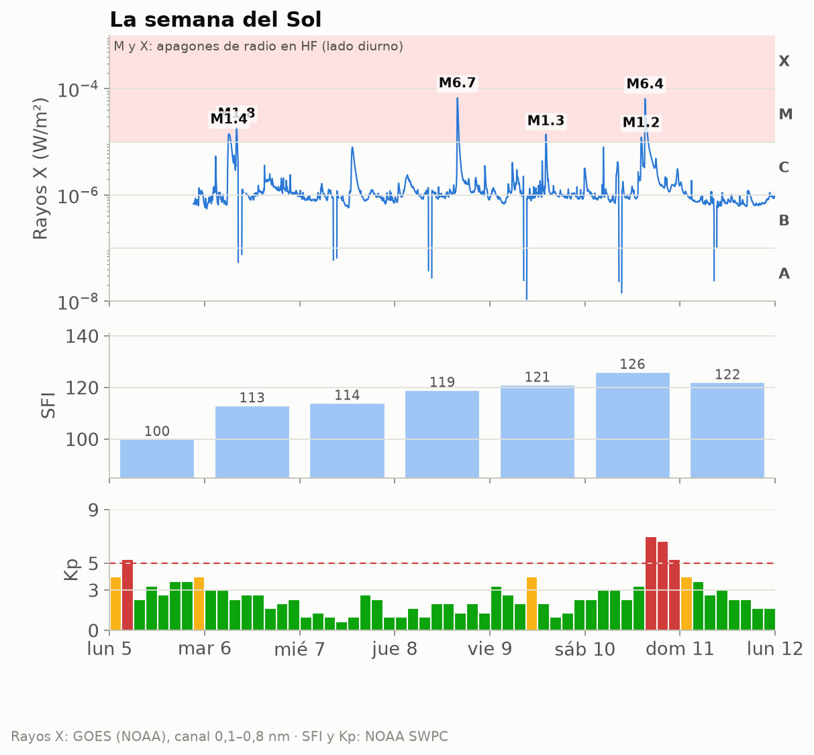
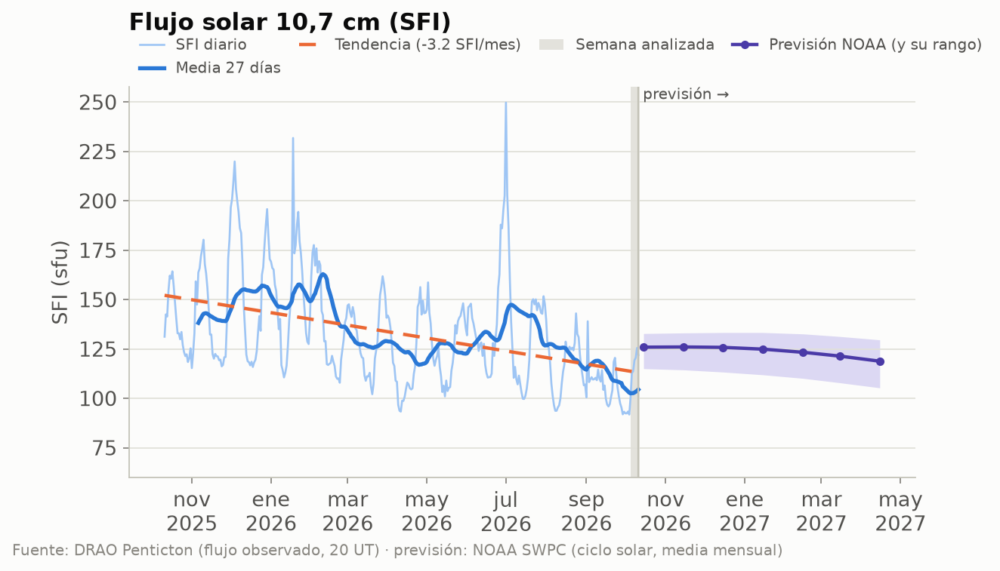
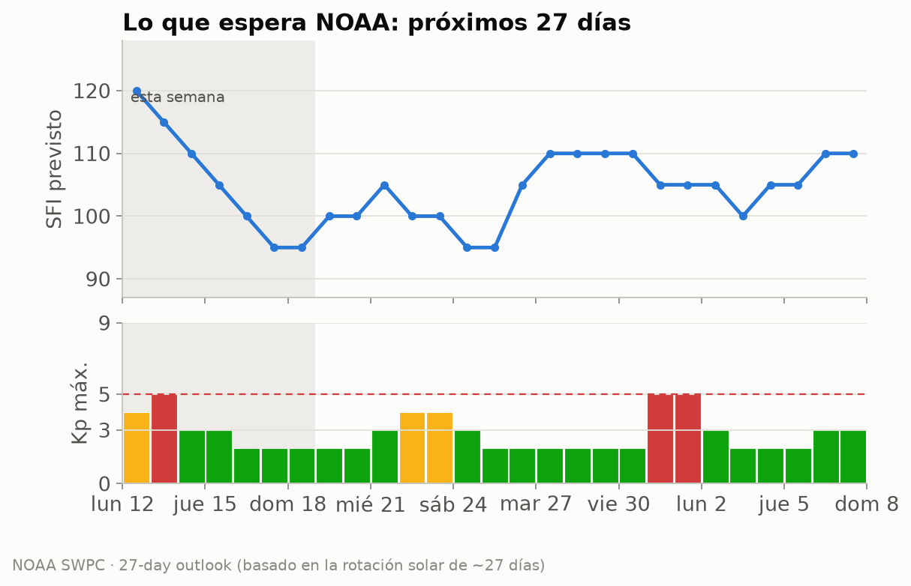
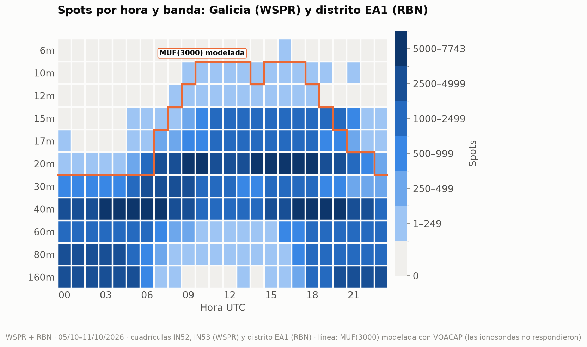
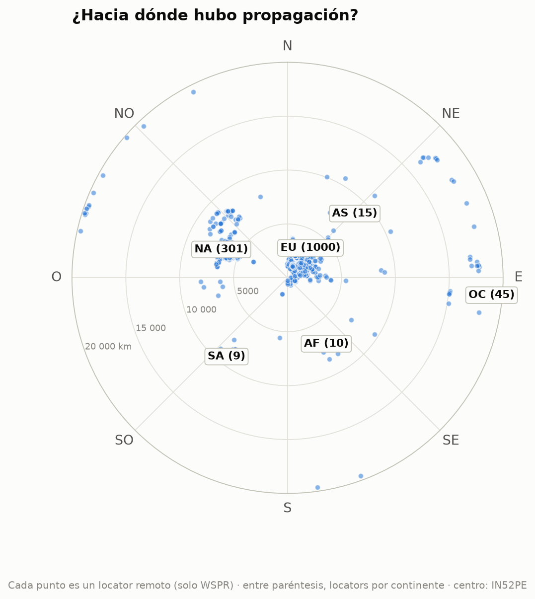
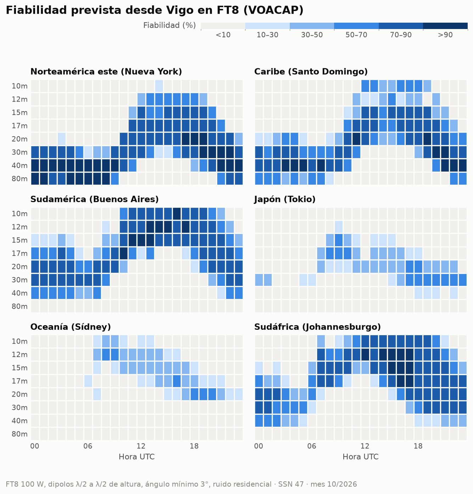

# Propagación HF/VHF desde Vigo · semana 2026-W42

**EA1RKV · Unión de Radioaficionados de Vigo-Val Miñor** · estación de referencia
Vigo (IN52PE) · semana analizada: 5 de octubre de 2026 – 11 de octubre de 2026 ·
previsión: lun 12/10 – dom 18/10

> Este informe combina **lo que dice la teoría** (índices solares, predicciones) con **lo que pasó
> de verdad** (spots reales desde Galicia). Todas las horas en UTC salvo que se indique lo contrario.

## 1. El Sol y el campo geomagnético

- **Flujo solar (SFI):** media **116**, máximo 126, mínimo 100 ·
  tendencia frente a la semana anterior: **al alza (+26 %)** (media previa 93).
- **SSN efectivo aproximado:** ≈ **60** (SSN ≈ 1,14·SFI − 73,2) · número de manchas observado (media): 81.
- **Campo geomagnético:** 🔴 **tormenta geomagnética (G3)** · Kp máximo **7,00** · Ap medio **17** (máx. 46) · 4 día(s) con Kp ≥ 4.
- **Fulguraciones:** 0 de clase X y 6 de clase M — la mayor, **M6.7** (jue 8/10 15:48 UTC). Una fulguración fuerte en el lado diurno puede provocar un *apagón de radio* (absorción en la capa D) durante minutos u horas.

| Día | SFI | Manchas | Ap | Kp máx. | |
|---|---:|---:|---:|---:|:-:|
| lun 5/10 | 100 | 58 | 24 | 5,33 | 🔴 |
| mar 6/10 | 113 | 77 | 11 | 3,00 | 🟢 |
| mié 7/10 | 114 | 78 | 6 | 2,67 | 🟢 |
| jue 8/10 | 119 | 69 | 6 | 2,00 | 🟢 |
| vie 9/10 | 121 | 93 | 11 | 4,00 | 🟡 |
| sáb 10/10 | 126 | 99 | 46 | 7,00 | 🔴 |
| dom 11/10 | 122 | 94 | 13 | 4,00 | 🟡 |

_Semáforo Kp: 🟢 ≤ 3 tranquilo · 🟡 4 inquieto · 🔴 ≥ 5 tormenta._

_Cómo leerla, de arriba abajo. **Rayos X:** cada pico es una fulguración; si entra en la franja
rosa (clases M y X), en la cara iluminada de la Tierra la capa D absorbe la HF durante minutos u
horas (el famoso «apagón de radio»). Los huecos de la línea son cortes de datos: cerca de los
equinoccios el satélite pasa cada día un rato por la sombra de la Tierra. **SFI:** cuanto más alto, más arriba llega la MUF.
**Kp:** agitación del campo magnético cada 3 horas; las barras rojas son tormenta._

_Estamos en la fase descendente del ciclo 25: el SFI baja poco a poco, con altibajos de ~27 días
(la rotación del Sol). La línea discontinua naranja marca la tendencia del último año; a la
derecha, en violeta, la previsión mensual de NOAA con su rango de incertidumbre (zona sombreada)._

### ¿Qué viene? Previsión de la actividad solar

**Próximos 3 días** (NOAA, la previsión más fiable; emitida el lun 12/10 12:30 UTC):

| Día | Kp máx. previsto | | Prob. apagón de radio R1–R2 | Prob. apagón fuerte (R3+) |
|---|---:|:-:|---:|---:|
| lun 12/10 | 4,00 | 🟡 | 55 % | 15 % |
| mar 13/10 | 5,00 | 🔴 | 50 % | 10 % |
| mié 14/10 | 3,67 | 🟢 | 45 % | 5 % |

_R1–R2 = fulguración M (apagón menor o moderado en la cara diurna); R3+ = fulguración X._

**Esta semana:** SFI entre 95 y 120, Ap máximo 28 y
Kp máximo 5 (🔴 tormenta geomagnética (G1)); días con Kp ≥ 4 previstos:
lun 12/10, mar 13/10.

**Hasta el sáb 7/11:** SFI entre 95 y 120; posible
agitación geomagnética (Kp ≥ 4) el lun 12/10, mar 13/10, jue 22/10, vie 23/10, sáb 31/10, dom 1/11.
_Esta previsión se basa en que el Sol gira sobre sí mismo cada ~27 días: las regiones activas y
los agujeros coronales que vimos hace una rotación suelen «volver a asomarse». Por eso acierta
bastante con las tendencias, pero no puede anticipar una fulguración concreta._

**A largo plazo:** NOAA prevé para abril de 2027 un SFI medio mensual de
**119** (entre 105 y 130). Es decir, el ciclo 25 sigue
bajando: poco a poco, 10 m y 12 m abrirán menos días. **Ojo:** la media de los últimos
27 días (104) va **por debajo** del rango que NOAA preveía para este mes
(unos 126): el Sol se está apagando más
deprisa de lo esperado, y las bandas altas lo notarán.

## 2. Lo que pasó de verdad desde Galicia

Esta semana se registraron **340 495 spots**: 299 987 de WSPR con una
estación gallega en un extremo (3 estaciones en las cuadrículas IN52/IN53) y
40 508 de la Reverse Beacon Network en CW/RTTY con una estación del **distrito EA1** (el RBN
no da locator, así que no podemos separar Galicia de Asturias, Cantabria y Castilla y León).
Las bandas con más actividad fueron **40m** (99 446), **20m** (76 505), **160m** (40 478), **80m** (34 113), y la hora más movida, las **18 UTC**.

_Cómo leerlo: cada casilla es una hora UTC en una banda; cuanto más oscura, más spots. Fíjate en
cómo las bandas altas (10–15 m) se «encienden» con el Sol y las bajas (40–80 m) de noche._

_La línea naranja es la **MUF(3000) modelada con VOACAP** para la semana pasada (con el SFI real
de esos días): esta semana las ionosondas no respondieron, así que es lo que dice el modelo, no una
medida. Por debajo de ella, la teoría dice que la banda abre para un salto de 3 000 km._

### DX de la semana por banda

| Banda | Distancia | Estación gallega (WSPR) | Corresponsal | Locator | Continente | Cuándo | SNR |
|---|---:|---|---|---|---|---|---:|
| 160m | 6 308 km | EB1A | N9AWU (oyó a Galicia) | EM69sm | Norteamérica | mar 6/10 04:54 UTC | -27 dB |
| 80m | 18 000 km | EB1A | VK7FLYN/2 (oyó a Galicia) | QE38lr | Oceanía | mié 7/10 19:42 UTC | -21 dB |
| 60m | 18 000 km | EB1A | VK7FLYN (oyó a Galicia) | QE38lr | Oceanía | vie 9/10 20:04 UTC | -24 dB |
| 40m | 19 820 km | EB1A | ZL2005SWL (oyó a Galicia) | RE68mx | Oceanía | mar 6/10 06:06 UTC | -25 dB |
| 30m | 19 820 km | EB1A | ZL2005SWL (oyó a Galicia) | RE68mx | Oceanía | mié 7/10 05:58 UTC | -27 dB |
| 20m | 19 820 km | EB1A | ZL2005SWL (oyó a Galicia) | RE68mx | Oceanía | mié 7/10 06:56 UTC | -26 dB |
| 17m | 18 000 km | EB1A | VK7FLYN/2 (oyó a Galicia) | QE38lr | Oceanía | jue 8/10 07:42 UTC | -26 dB |
| 15m | 17 837 km | EB1A | VK2JPB (oyó a Galicia) | QF59tl | Oceanía | jue 8/10 13:54 UTC | -23 dB |

_Distancias de círculo máximo medidas desde IN52PE (WSPR)._

### Rutas por continente

Spots de WSPR (Galicia) y RBN (distrito EA1) juntos, por continente del corresponsal:

| Continente | Spots | 160m | 80m | 60m | 40m | 30m | 20m | 17m | 15m | 12m | 10m | 6m | 
|---|---:|---:|---:|---:|---:|---:|---:|---:|---:|---:|---:|---:|
| Europa | **289 831** | 38286 | 32241 | 20302 | 88286 | 28958 | 61862 | 10541 | 9286 | 26 | 42 | 1 | 
| Norteamérica | **38 844** | 862 | 1334 | 3053 | 8114 | 1491 | 12546 | 3592 | 7795 | 30 | 27 | · | 
| África | **7 183** | 1330 | 512 | 547 | 1294 | 840 | 935 | 830 | 880 | 7 | 8 | · | 
| Oceanía | **2 873** | · | 24 | 67 | 1285 | 505 | 742 | 146 | 104 | · | · | · | 
| Sudamérica | **920** | · | · | · | 218 | 37 | 81 | 81 | 395 | 6 | 102 | · | 
| Asia | **844** | · | 2 | 1 | 249 | 38 | 339 | 41 | 169 | 3 | 2 | · | 

_Mapa centrado en Vigo: el ángulo es el rumbo al que apuntaría tu antena y la distancia al centro,
los kilómetros. Solo WSPR, porque el RBN no da locator: cada punto es un locator distinto
(1 380 en total) y la cifra entre paréntesis es cuántos hay de cada continente. Por eso no
coincide con los spots de la tabla, que suman todos los spots de WSPR y RBN._

### La ionosfera medida

_Sin datos esta semana: el servidor de GIRO (lgdc.uml.edu) no respondió a ninguna de las ionosondas, así que esta semana no hay medidas de foF2, MUF ni esporádica E._

## 3. Previsión para la semana (lun 12/10 – dom 18/10)

### DX: fiabilidad prevista (VOACAP)

**En FT8** (el modo más usado, y el más parecido a los spots WSPR/RBN de la sección 2): bandas con
fiabilidad media ≥ 50 % por franja horaria (UTC), la mejor primero. En cursiva, la mejor banda
cuando ninguna llega al 50 % (apertura posible pero poco fiable):

| Destino | km | Rumbo | 00–04 | 04–08 | 08–12 | 12–16 | 16–20 | 20–24 | 
|---|---:|---:|---|---|---|---|---|---|
| Norteamérica este (Nueva York) | 5 307 | 291° | 40m, 80m, 30m | 80m, 40m, 30m | 40m, 30m | 17m, 20m, 15m | 20m, 17m, 15m | 40m, 30m, 20m | 
| Caribe (Santo Domingo) | 6 288 | 265° | 40m, 30m, 80m | 40m, 30m, 80m | 30m, 20m, 40m | 17m, 15m, 20m | 17m, 15m, 20m | 30m, 40m, 20m | 
| Sudamérica (Buenos Aires) | 9 922 | 219° | 20m, 30m, 17m | 30m, 20m, 40m | 17m, 15m | 12m, 15m, 10m | 10m, 12m, 15m | 17m, 20m, 15m | 
| Japón (Tokio) | 10 780 | 25° | _30m (20 %)_ | — | 17m | _20m (44 %)_ | 30m, 20m | 30m | 
| Oceanía (Sídney) | 18 035 | 69° | — | — | _12m (48 %)_ | _15m (39 %)_ | _20m (45 %)_ | _20m (32 %)_ | 
| Sudáfrica (Johannesburgo) | 8 489 | 146° | 20m, 30m, 40m | _20m (43 %)_ | 12m, 15m | 12m, 10m, 15m | 12m, 15m, 17m | 20m, 17m, 30m | 

**En CW** (a oído hace falta unos 14 dB más de señal que en FT8, así que se abren menos bandas):

| Destino | 00–04 | 04–08 | 08–12 | 12–16 | 16–20 | 20–24 | 
|---|---|---|---|---|---|---|
| Norteamérica este (Nueva York) | 40m, 30m, 80m | 40m, 80m | _30m (50 %)_ | 17m | 20m, 17m, 15m | 40m, 30m | 
| Caribe (Santo Domingo) | 40m | 40m | _20m (37 %)_ | _15m (44 %)_ | 17m, 15m | 30m, 40m | 
| Sudamérica (Buenos Aires) | 20m | _20m (44 %)_ | _15m (42 %)_ | 12m, 10m | 10m, 12m | 17m | 
| Japón (Tokio) | — | — | _17m (27 %)_ | — | _20m (24 %)_ | _30m (24 %)_ | 
| Oceanía (Sídney) | — | — | _12m (22 %)_ | — | _17m (20 %)_ | — | 
| Sudáfrica (Johannesburgo) | _20m (48 %)_ | — | _12m (48 %)_ | 12m, 10m | 12m, 10m, 15m | 17m, 20m | 

_Supuestos: 100 W, dipolos de media onda a media longitud de onda de altura en los dos extremos,
ángulo de salida mínimo de 3° y ruido residencial. SSN usado: **47** (SSN efectivo del SFI previsto (106)).
En SSB hacen falta ~30 dB más que en FT8. VOACAP describe el promedio mensual: un día concreto puede
ir mucho mejor o peor._

### NVIS y contactos regionales (80 y 40 m)

_Sin datos esta semana: el servidor de GIRO (lgdc.uml.edu) no respondió a ninguna de las ionosondas, así que esta semana no hay medidas de foF2, MUF ni esporádica E._

### Línea gris

El jue 15/10, en Vigo amanece a las **06:47 UTC** y anochece a las **17:53 UTC**.
Durante el crepúsculo la absorción de la capa D desaparece antes de que se deshaga la capa F: es
el momento de buscar DX en 160, 80 y 40 m a lo largo del terminador.

| Destino | Orto DX | Ocaso DX | Terminador común (±45 min) | Noche en los dos extremos |
|---|---|---|---|---|
| Norteamérica este (Nueva York) | 11:07 | 22:15 | — | 22:17–06:47 |
| Caribe (Santo Domingo) | 10:33 | 22:17 | — | 22:17–06:47 |
| Sudamérica (Buenos Aires) | 09:11 | 22:07 | — | 22:06–06:47 |
| Japón (Tokio) | 20:47 | 08:06 | 07:21–07:32 UTC (orto Vigo / ocaso DX) | 17:53–20:48 |
| Oceanía (Sídney) | 19:14 | 08:08 | 18:28–18:38 UTC (ocaso Vigo / orto DX) | 17:53–19:13 |
| Sudáfrica (Johannesburgo) | 03:33 | 16:14 | — | 17:54–03:33 |

_El «terminador común» es la línea gris propiamente dicha (amanecer o anochecer a la vez en los dos
extremos). La «noche en los dos extremos» es la ventana para 160 y 80 m, y a menudo para 40 m._

## 4. Agenda y efemérides

### Concursos del fin de semana

| Concurso | Empieza (UTC) | Termina (UTC) | Horas |
|---|---|---|---:|
| [K1USN Slow Speed Test](https://www.contestcalendar.com/weeklycontdetails.php?ref=003fsw21) | vie 16/10 20:00 | vie 16/10 21:00 | 1 |
| [JARL WW RTTY Contest](https://www.contestcalendar.com/weeklycontdetails.php?ref=003fjnv5) | sáb 17/10 00:00 | lun 19/10 00:00 | 48 |
| [New York QSO Party](https://www.contestcalendar.com/weeklycontdetails.php?ref=003b1uhl) | sáb 17/10 14:00 | dom 18/10 02:00 | 12 |
| [Worked All Germany Contest](https://www.contestcalendar.com/weeklycontdetails.php?ref=003fmvlv) | sáb 17/10 15:00 | dom 18/10 14:59 | 24 |
| [Stew Perry Topband Challenge](https://www.contestcalendar.com/weeklycontdetails.php?ref=003fllcf) | sáb 17/10 15:00 | dom 18/10 15:00 | 24 |
| [Feld Hell Sprint](https://www.contestcalendar.com/weeklycontdetails.php?ref=003fbb5g) | sáb 17/10 20:00 | sáb 17/10 23:59 | 4 |
| [Argentina National 7 MHz Contest](https://www.contestcalendar.com/weeklycontdetails.php?ref=003fh3my) | sáb 17/10 21:30 | sáb 17/10 23:30 | 2 |
| [Asia-Pacific Fall Sprint, CW](https://www.contestcalendar.com/weeklycontdetails.php?ref=003fhipg) | dom 18/10 00:00 | dom 18/10 02:00 | 2 |
| [UBA ON Contest, 2m](https://www.contestcalendar.com/weeklycontdetails.php?ref=003fm0qt) | dom 18/10 07:00 | dom 18/10 10:00 | 3 |
| [Illinois QSO Party](https://www.contestcalendar.com/weeklycontdetails.php?ref=003b21yv) | dom 18/10 17:00 | lun 19/10 01:00 | 8 |
| [Run for the Bacon QRP Contest](https://www.contestcalendar.com/weeklycontdetails.php?ref=003feb4x) | dom 18/10 23:00 | lun 19/10 01:00 | 2 |

### Lluvias de meteoros (meteor scatter en 6 m y 2 m)

- **Oriónidas** — máximo mié 21/10 (dentro de 9 días), THZ ≈ 20 · _activa esta semana_.

_Consejo: el meteor scatter funciona mejor al amanecer local, cuando la Tierra «barre» los
meteoros de frente. Modos: MSK144 (6 m/2 m) con WSJT-X._

### Pases de satélites desde Vigo

Los mejores pases (elevación máxima ≥ 30°) de cada satélite:

| Satélite | Día | AOS (UTC) | LOS (UTC) | Hora local | Elev. máx. | Min |
|---|---|---|---|---|---:|---:|
| AO-7 | lun 12/10 | 18:04 | 18:26 | 20:04 | 80° | 22 |
| RS-44 | mar 13/10 | 03:46 | 04:08 | 05:46 | 82° | 22 |
| AO-123 | mar 13/10 | 09:00 | 09:11 | 11:00 | 66° | 11 |
| AO-27 | mar 13/10 | 11:18 | 11:33 | 13:18 | 70° | 15 |
| ISS | mié 14/10 | 06:43 | 06:54 | 08:43 | 89° | 11 |
| SO-50 | mié 14/10 | 08:54 | 09:08 | 10:54 | 66° | 14 |
| RS-44 | mié 14/10 | 16:47 | 17:10 | 18:47 | 82° | 24 |
| SO-50 | mié 14/10 | 17:23 | 17:36 | 19:23 | 68° | 14 |
| FO-29 | mié 14/10 | 19:27 | 19:42 | 21:27 | 87° | 15 |
| AO-27 | mié 14/10 | 22:06 | 22:21 | 00:06 | 84° | 15 |
| AO-7 | jue 15/10 | 07:51 | 08:13 | 09:51 | 83° | 22 |
| AO-123 | vie 16/10 | 08:52 | 09:03 | 10:52 | 87° | 11 |
| ISS | vie 16/10 | 11:38 | 11:49 | 13:38 | 77° | 11 |
| FO-29 | vie 16/10 | 19:21 | 19:37 | 21:21 | 85° | 15 |
| AO-123 | vie 16/10 | 21:46 | 21:57 | 23:46 | 82° | 11 |
| RS-44 | sáb 17/10 | 03:28 | 03:49 | 05:28 | 90° | 21 |
| AO-7 | sáb 17/10 | 07:43 | 08:06 | 09:43 | 90° | 22 |
| AO-27 | sáb 17/10 | 10:57 | 11:12 | 12:57 | 77° | 15 |
| SO-50 | sáb 17/10 | 16:35 | 16:48 | 18:35 | 67° | 14 |
| ISS | dom 18/10 | 05:10 | 05:21 | 07:10 | 88° | 11 |
| FO-29 | dom 18/10 | 06:22 | 06:40 | 08:22 | 87° | 18 |

## 5. Comentario del club

<!-- COMENTARIO -->
> PENDIENTE: un socio debe escribir aquí su comentario (qué trabajó, qué oyó, qué recomienda
> para la semana). **El informe no se publica sin este párrafo.**
<!-- /COMENTARIO -->

---

### Fuentes

- NOAA SWPC — índices solares y geomagnéticos diarios, flujo de rayos X y fulguraciones de GOES, previsión a 3 y 27 días y previsión del ciclo solar (https://www.swpc.noaa.gov/)
- NRC Canada / DRAO Penticton — histórico diario del flujo F10.7 (https://www.spaceweather.gc.ca/)
- WSPRnet vía wspr.live (https://wspr.live/)
- Reverse Beacon Network (https://www.reversebeacon.net/)
- VOACAP (voacapl, port para Linux de J. Watson; https://github.com/jawatson/voacapl)
- WA7BNM Contest Calendar (https://www.contestcalendar.com/)
- International Meteor Organization — calendario de lluvias (https://www.imo.net/)
- CelesTrak — TLE de satélites de radioaficionado (https://celestrak.org/)
- Cálculos propios: SSN efectivo, distancias de círculo máximo, MUF por ley de la secante y
  orto/ocaso (algoritmo de NOAA).

Borrador generado automáticamente el 2026-10-12 21:17 UTC por el script del radioclub
EA1RKV. Las secciones sin datos indican que la fuente no respondió esta semana.
