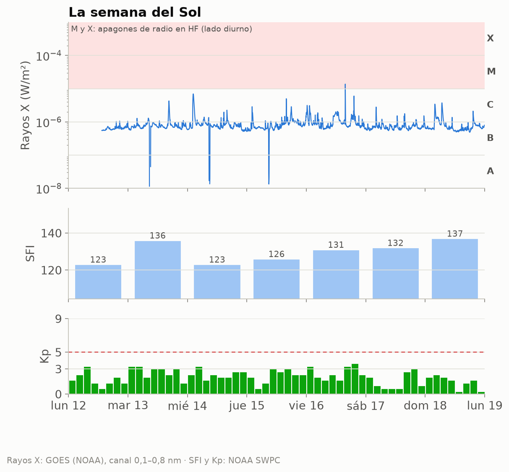
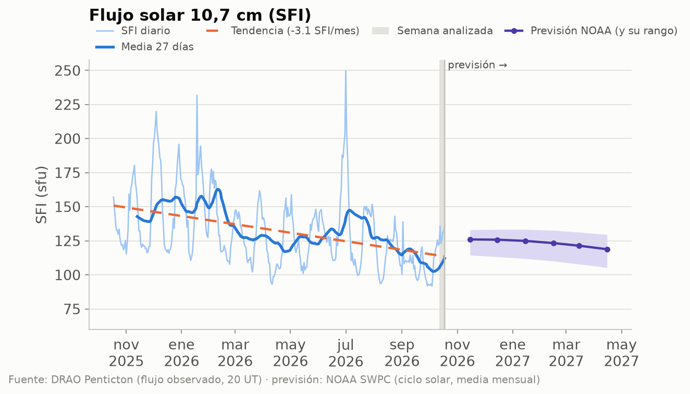
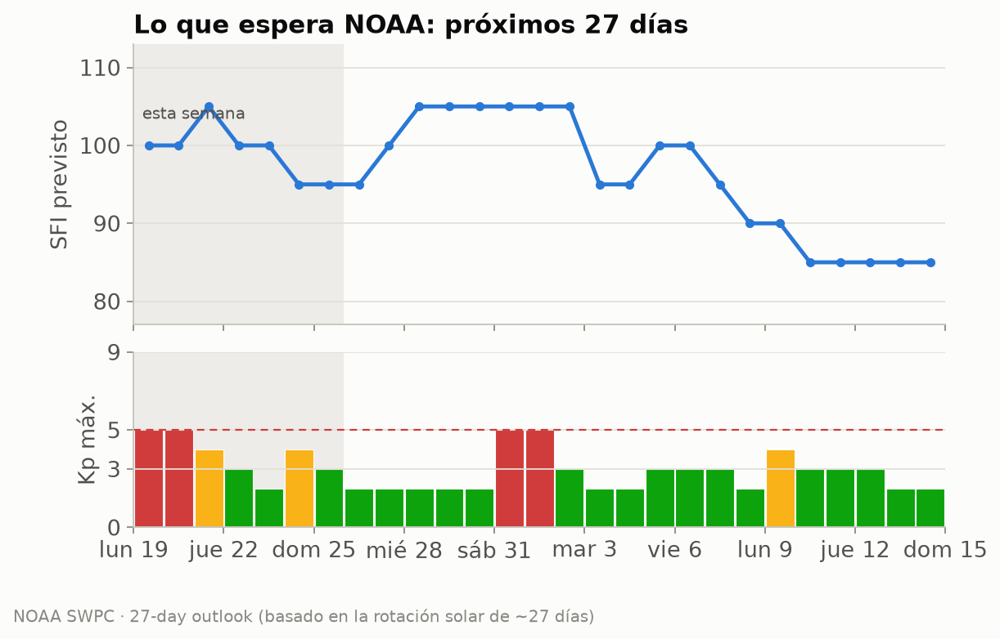
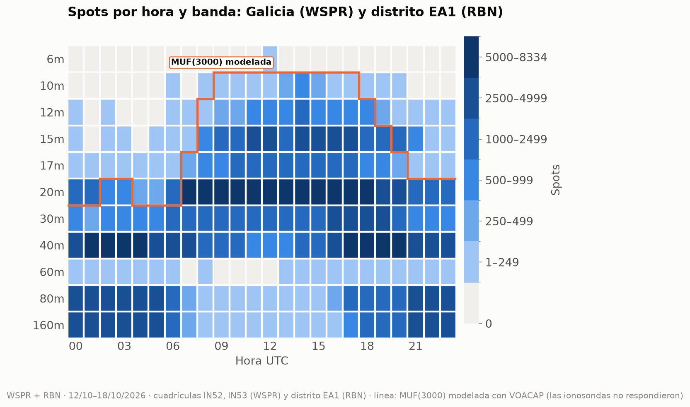
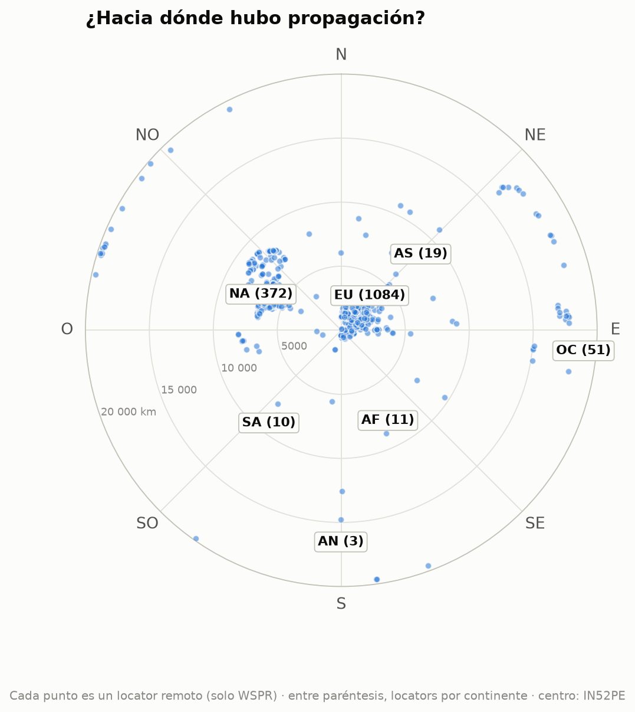
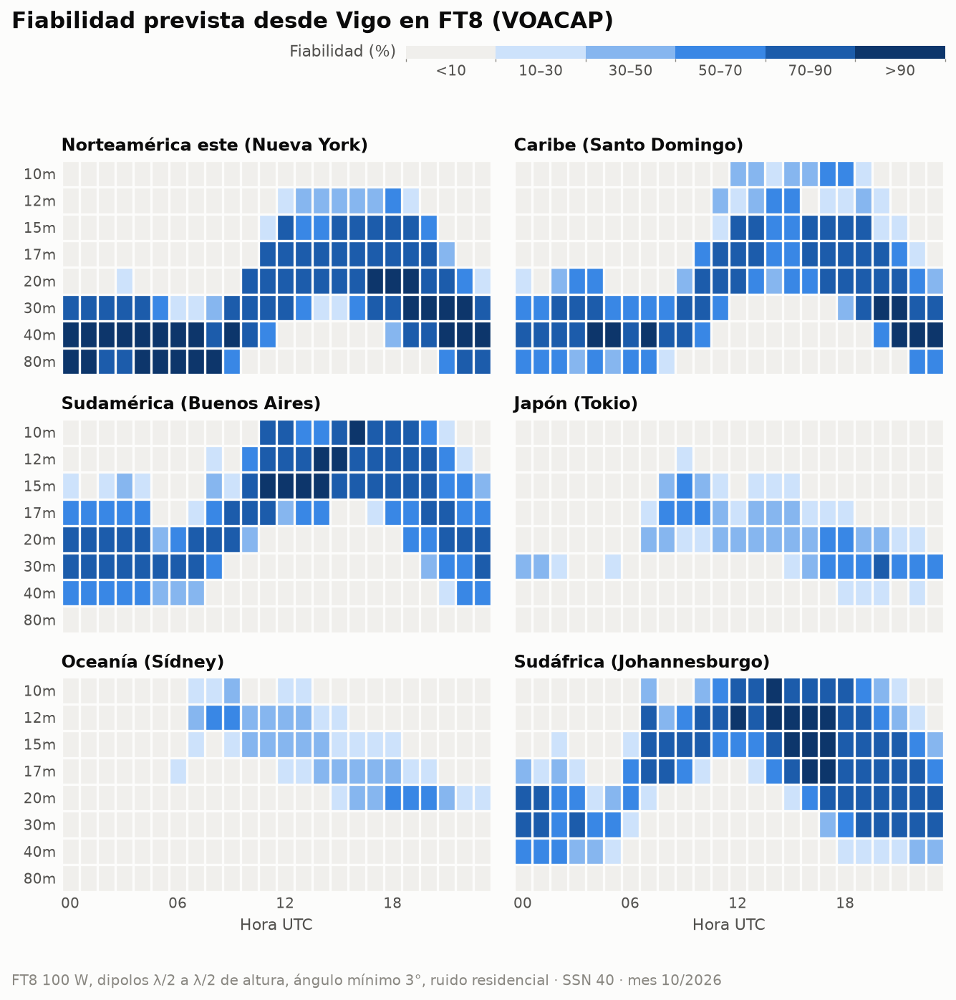

# Propagación HF/VHF desde Vigo · semana 2026-W43

**EA1RKV · Unión de Radioaficionados de Vigo-Val Miñor** · estación de referencia
Vigo (IN52PE) · semana analizada: 12 de octubre de 2026 – 18 de octubre de 2026 ·
previsión: lun 19/10 – dom 25/10

> Este informe combina **lo que dice la teoría** (índices solares, predicciones) con **lo que pasó
> de verdad** (spots reales desde Galicia). Todas las horas en UTC salvo que se indique lo contrario.

## 1. El Sol y el campo geomagnético

- **Flujo solar (SFI):** media **130**, máximo 137, mínimo 123 ·
  tendencia frente a la semana anterior: **al alza (+11 %)** (media previa 116).
- **SSN efectivo aproximado:** ≈ **75** (SSN ≈ 1,14·SFI − 73,2) · número de manchas observado (media): 96.
- **Campo geomagnético:** 🟢 **tranquilo** · Kp máximo **3,67** · Ap medio **9** (máx. 13).
- **Fulguraciones:** 0 de clase X y 1 de clase M. Una fulguración fuerte en el lado diurno puede provocar un *apagón de radio* (absorción en la capa D) durante minutos u horas.

| Día | SFI | Manchas | Ap | Kp máx. | |
|---|---:|---:|---:|---:|:-:|
| lun 12/10 | 123 | 93 | 7 | 3,33 | 🟢 |
| mar 13/10 | 136 | 102 | 13 | 3,33 | 🟢 |
| mié 14/10 | 123 | 124 | 10 | 3,33 | 🟢 |
| jue 15/10 | 126 | 104 | 9 | 3,00 | 🟢 |
| vie 16/10 | 131 | 81 | 12 | 3,67 | 🟢 |
| sáb 17/10 | 132 | 87 | 6 | 3,00 | 🟢 |
| dom 18/10 | 137 | 82 | 6 | 2,33 | 🟢 |

_Semáforo Kp: 🟢 ≤ 3 tranquilo · 🟡 4 inquieto · 🔴 ≥ 5 tormenta._

_Cómo leerla, de arriba abajo. **Rayos X:** cada pico es una fulguración; si entra en la franja
rosa (clases M y X), en la cara iluminada de la Tierra la capa D absorbe la HF durante minutos u
horas (el famoso «apagón de radio»). Los huecos de la línea son cortes de datos: cerca de los
equinoccios el satélite pasa cada día un rato por la sombra de la Tierra. **SFI:** cuanto más alto, más arriba llega la MUF.
**Kp:** agitación del campo magnético cada 3 horas; las barras rojas son tormenta._

_Estamos en la fase descendente del ciclo 25: el SFI baja poco a poco, con altibajos de ~27 días
(la rotación del Sol). La línea discontinua naranja marca la tendencia del último año; a la
derecha, en violeta, la previsión mensual de NOAA con su rango de incertidumbre (zona sombreada)._

### ¿Qué viene? Previsión de la actividad solar

**Próximos 3 días** (NOAA, la previsión más fiable; emitida el lun 19/10 12:30 UTC):

| Día | Kp máx. previsto | | Prob. apagón de radio R1–R2 | Prob. apagón fuerte (R3+) |
|---|---:|:-:|---:|---:|
| lun 19/10 | 4,67 | 🟡 | 30 % | 10 % |
| mar 20/10 | 4,67 | 🟡 | 30 % | 10 % |
| mié 21/10 | 3,33 | 🟢 | 30 % | 10 % |

_R1–R2 = fulguración M (apagón menor o moderado en la cara diurna); R3+ = fulguración X._

**Esta semana:** SFI entre 95 y 105, Ap máximo 22 y
Kp máximo 5 (🔴 tormenta geomagnética (G1)); días con Kp ≥ 4 previstos:
lun 19/10, mar 20/10, mié 21/10, sáb 24/10.

**Hasta el sáb 14/11:** SFI entre 85 y 105; posible
agitación geomagnética (Kp ≥ 4) el lun 19/10, mar 20/10, mié 21/10, sáb 24/10, sáb 31/10, dom 1/11, lun 9/11.
_Esta previsión se basa en que el Sol gira sobre sí mismo cada ~27 días: las regiones activas y
los agujeros coronales que vimos hace una rotación suelen «volver a asomarse». Por eso acierta
bastante con las tendencias, pero no puede anticipar una fulguración concreta._

**A largo plazo:** NOAA prevé para abril de 2027 un SFI medio mensual de
**119** (entre 105 y 130). Es decir, el ciclo 25 sigue
bajando: poco a poco, 10 m y 12 m abrirán menos días. **Ojo:** la media de los últimos
27 días (112) va **por debajo** del rango que NOAA preveía para este mes
(unos 126): el Sol se está apagando más
deprisa de lo esperado, y las bandas altas lo notarán.

## 2. Lo que pasó de verdad desde Galicia

Esta semana se registraron **364 672 spots**: 299 863 de WSPR con una
estación gallega en un extremo (8 estaciones en las cuadrículas IN52/IN53) y
64 809 de la Reverse Beacon Network en CW/RTTY con una estación del **distrito EA1** (el RBN
no da locator, así que no podemos separar Galicia de Asturias, Cantabria y Castilla y León).
Las bandas con más actividad fueron **40m** (96 229), **20m** (95 117), **160m** (39 682), **80m** (38 163), y la hora más movida, las **18 UTC**.

_Cómo leerlo: cada casilla es una hora UTC en una banda; cuanto más oscura, más spots. Fíjate en
cómo las bandas altas (10–15 m) se «encienden» con el Sol y las bajas (40–80 m) de noche._

_La línea naranja es la **MUF(3000) modelada con VOACAP** para la semana pasada (con el SFI real
de esos días): esta semana las ionosondas no respondieron, así que es lo que dice el modelo, no una
medida. Por debajo de ella, la teoría dice que la banda abre para un salto de 3 000 km._

### DX de la semana por banda

| Banda | Distancia | Estación gallega (WSPR) | Corresponsal | Locator | Continente | Cuándo | SNR |
|---|---:|---|---|---|---|---|---:|
| 160m | 5 500 km | EB1A | VE3EID (oyó a Galicia) | FN05gk | Norteamérica | sáb 17/10 04:48 UTC | -27 dB |
| 80m | 17 045 km | EB1A | VK5ARG (oyó a Galicia) | PF95ht | Oceanía | vie 16/10 17:12 UTC | -28 dB |
| 40m | 19 820 km | EB1A | ZL2005SWL (oyó a Galicia) | RE68mx | Oceanía | sáb 17/10 17:48 UTC | -26 dB |
| 30m | 19 820 km | EB1A | ZL2005SWL (oyó a Galicia) | RE68mx | Oceanía | dom 18/10 05:42 UTC | -22 dB |
| 20m | 19 828 km | EB1A | ZL3TKI (oyó a Galicia) | RE66hk | Oceanía | dom 18/10 07:24 UTC | -26 dB |
| 17m | 18 000 km | EB1A | VK2EFM (oyó a Galicia) | QF56oq | Oceanía | vie 16/10 13:38 UTC | -25 dB |
| 15m | 19 820 km | EB1A | ZL2005SWL (oyó a Galicia) | RE68mx | Oceanía | dom 18/10 08:34 UTC | -23 dB |
| 12m | 15 116 km | EB1A | VK6XT (oyó a Galicia) | OF88ji | Oceanía | mar 13/10 08:44 UTC | -26 dB |

_Distancias de círculo máximo medidas desde IN52PE (WSPR)._

### Rutas por continente

Spots de WSPR (Galicia) y RBN (distrito EA1) juntos, por continente del corresponsal:

| Continente | Spots | 160m | 80m | 60m | 40m | 30m | 20m | 17m | 15m | 12m | 10m | 6m | 
|---|---:|---:|---:|---:|---:|---:|---:|---:|---:|---:|---:|---:|
| Europa | **301 813** | 38316 | 35631 | 160 | 84647 | 33126 | 72912 | 14408 | 18985 | 2798 | 829 | 1 | 
| Norteamérica | **50 901** | 48 | 1932 | 1 | 9343 | 2150 | 19349 | 3203 | 10231 | 3899 | 745 | · | 
| África | **6 676** | 1318 | 566 | · | 1211 | 921 | 920 | 610 | 668 | 432 | 30 | · | 
| Oceanía | **2 521** | · | 26 | · | 610 | 471 | 1263 | 128 | 21 | 2 | · | · | 
| Sudamérica | **1 420** | · | 2 | · | 113 | 7 | 228 | 95 | 459 | 247 | 269 | · | 
| Asia | **1 331** | · | 6 | · | 304 | 77 | 445 | 33 | 372 | 60 | 34 | · | 
| Antártida | **10** | · | · | · | 1 | 9 | · | · | · | · | · | · | 

_Mapa centrado en Vigo: el ángulo es el rumbo al que apuntaría tu antena y la distancia al centro,
los kilómetros. Solo WSPR, porque el RBN no da locator: cada punto es un locator distinto
(1 550 en total) y la cifra entre paréntesis es cuántos hay de cada continente. Por eso no
coincide con los spots de la tabla, que suman todos los spots de WSPR y RBN._

### La ionosfera medida

_Sin datos esta semana: el servidor de GIRO (lgdc.uml.edu) no respondió a ninguna de las ionosondas, así que esta semana no hay medidas de foF2, MUF ni esporádica E._

## 3. Previsión para la semana (lun 19/10 – dom 25/10)

### DX: fiabilidad prevista (VOACAP)

**En FT8** (el modo más usado, y el más parecido a los spots WSPR/RBN de la sección 2): bandas con
fiabilidad media ≥ 50 % por franja horaria (UTC), la mejor primero. En cursiva, la mejor banda
cuando ninguna llega al 50 % (apertura posible pero poco fiable):

| Destino | km | Rumbo | 00–04 | 04–08 | 08–12 | 12–16 | 16–20 | 20–24 | 
|---|---:|---:|---|---|---|---|---|---|
| Norteamérica este (Nueva York) | 5 307 | 291° | 40m, 80m, 30m | 80m, 40m | 40m, 30m | 20m, 17m, 15m | 20m, 17m, 15m | 40m, 30m, 20m | 
| Caribe (Santo Domingo) | 6 288 | 265° | 40m, 30m, 80m | 40m, 30m, 80m | 30m, 40m, 20m | 17m, 15m, 20m | 17m, 15m, 20m | 30m, 40m, 20m | 
| Sudamérica (Buenos Aires) | 9 922 | 219° | 20m, 30m, 40m | 30m, 20m, 40m | 17m, 15m | 12m, 15m, 10m | 12m, 10m, 15m | 20m, 17m, 15m | 
| Japón (Tokio) | 10 780 | 25° | _30m (21 %)_ | — | 17m | _20m (44 %)_ | 30m | 30m | 
| Oceanía (Sídney) | 18 035 | 69° | — | — | _12m (45 %)_ | _15m (37 %)_ | _20m (46 %)_ | _20m (29 %)_ | 
| Sudáfrica (Johannesburgo) | 8 489 | 146° | 30m, 20m, 40m | _20m (40 %)_ | 15m, 12m | 12m, 10m, 15m | 15m, 12m, 17m | 20m, 30m, 17m | 

**En CW** (a oído hace falta unos 14 dB más de señal que en FT8, así que se abren menos bandas):

| Destino | 00–04 | 04–08 | 08–12 | 12–16 | 16–20 | 20–24 | 
|---|---|---|---|---|---|---|
| Norteamérica este (Nueva York) | 40m, 30m, 80m | 40m, 80m | _30m (47 %)_ | _20m (50 %)_ | 20m, 17m, 15m | 40m, 30m | 
| Caribe (Santo Domingo) | 40m | 40m | _20m (34 %)_ | _15m (42 %)_ | 17m, 15m | 30m, 40m | 
| Sudamérica (Buenos Aires) | 20m | _30m (45 %)_ | _15m (38 %)_ | 12m | 10m, 12m | _20m (46 %)_ | 
| Japón (Tokio) | — | — | _17m (27 %)_ | — | _20m (23 %)_ | _30m (31 %)_ | 
| Oceanía (Sídney) | — | — | _12m (20 %)_ | — | — | — | 
| Sudáfrica (Johannesburgo) | _20m (44 %)_ | — | _12m (40 %)_ | 12m, 10m | 12m, 15m, 10m | _17m (47 %)_ | 

_Supuestos: 100 W, dipolos de media onda a media longitud de onda de altura en los dos extremos,
ángulo de salida mínimo de 3° y ruido residencial. SSN usado: **40** (SSN efectivo del SFI previsto (99)).
En SSB hacen falta ~30 dB más que en FT8. VOACAP describe el promedio mensual: un día concreto puede
ir mucho mejor o peor._

### NVIS y contactos regionales (80 y 40 m)

_Sin datos esta semana: el servidor de GIRO (lgdc.uml.edu) no respondió a ninguna de las ionosondas, así que esta semana no hay medidas de foF2, MUF ni esporádica E._

### Línea gris

El jue 22/10, en Vigo amanece a las **06:55 UTC** y anochece a las **17:42 UTC**.
Durante el crepúsculo la absorción de la capa D desaparece antes de que se deshaga la capa F: es
el momento de buscar DX en 160, 80 y 40 m a lo largo del terminador.

| Destino | Orto DX | Ocaso DX | Terminador común (±45 min) | Noche en los dos extremos |
|---|---|---|---|---|
| Norteamérica este (Nueva York) | 11:14 | 22:05 | — | 22:06–06:55 |
| Caribe (Santo Domingo) | 10:35 | 22:12 | — | 22:12–06:55 |
| Sudamérica (Buenos Aires) | 09:02 | 22:13 | — | 22:12–06:55 |
| Japón (Tokio) | 20:53 | 07:57 | 07:12–07:40 UTC (orto Vigo / ocaso DX) | 17:42–20:54 |
| Oceanía (Sídney) | 19:05 | 08:14 | 07:29–07:40 UTC (orto Vigo / ocaso DX) | 17:42–19:04 |
| Sudáfrica (Johannesburgo) | 03:26 | 16:18 | — | 17:43–03:26 |

_El «terminador común» es la línea gris propiamente dicha (amanecer o anochecer a la vez en los dos
extremos). La «noche en los dos extremos» es la ventana para 160 y 80 m, y a menudo para 40 m._

## 4. Agenda y efemérides

### Concursos del fin de semana

| Concurso | Empieza (UTC) | Termina (UTC) | Horas |
|---|---|---|---:|
| [ARRL School Club Roundup](https://www.contestcalendar.com/weeklycontdetails.php?ref=003fhb26) | lun 19/10 13:00 | vie 23/10 23:59 | 107 |
| [K1USN Slow Speed Test](https://www.contestcalendar.com/weeklycontdetails.php?ref=003ft3rt) | vie 23/10 20:00 | vie 23/10 21:00 | 1 |
| [CQ Worldwide DX Contest, SSB](https://www.contestcalendar.com/weeklycontdetails.php?ref=003fidks) | sáb 24/10 00:00 | dom 25/10 23:59 | 48 |

### Lluvias de meteoros (meteor scatter en 6 m y 2 m)

- **Oriónidas** — máximo mié 21/10 (dentro de 2 días), THZ ≈ 20 · _activa esta semana_.
- **Leónidas** — máximo mar 17/11 (dentro de 29 días), THZ ≈ 15.

_Consejo: el meteor scatter funciona mejor al amanecer local, cuando la Tierra «barre» los
meteoros de frente. Modos: MSK144 (6 m/2 m) con WSJT-X._

### Pases de satélites desde Vigo

Los mejores pases (elevación máxima ≥ 30°) de cada satélite:

| Satélite | Día | AOS (UTC) | LOS (UTC) | Hora local | Elev. máx. | Min |
|---|---|---|---|---|---:|---:|
| AO-7 | lun 19/10 | 07:36 | 07:59 | 09:36 | 83° | 22 |
| AO-123 | lun 19/10 | 08:44 | 08:55 | 10:44 | 72° | 11 |
| AO-123 | lun 19/10 | 21:38 | 21:49 | 23:38 | 75° | 11 |
| FO-29 | mar 20/10 | 06:16 | 06:35 | 08:16 | 87° | 18 |
| ISS | mar 20/10 | 10:05 | 10:16 | 12:05 | 78° | 11 |
| AO-27 | mar 20/10 | 11:07 | 11:22 | 13:07 | 88° | 15 |
| SO-50 | mar 20/10 | 15:46 | 16:00 | 17:46 | 67° | 14 |
| RS-44 | mié 21/10 | 03:09 | 03:31 | 05:09 | 82° | 21 |
| RS-44 | mié 21/10 | 15:46 | 16:10 | 17:46 | 85° | 23 |
| AO-27 | mié 21/10 | 21:55 | 22:10 | 23:55 | 78° | 15 |
| ISS | jue 22/10 | 03:38 | 03:49 | 05:38 | 87° | 11 |
| FO-29 | jue 22/10 | 06:11 | 06:29 | 08:11 | 81° | 18 |
| SO-50 | vie 23/10 | 14:58 | 15:12 | 16:58 | 67° | 14 |
| AO-7 | vie 23/10 | 18:21 | 18:43 | 20:21 | 85° | 22 |
| FO-29 | sáb 24/10 | 06:06 | 06:23 | 08:06 | 76° | 17 |
| ISS | sáb 24/10 | 08:32 | 08:43 | 10:32 | 79° | 11 |
| AO-123 | sáb 24/10 | 09:01 | 09:12 | 11:01 | 65° | 11 |
| AO-27 | sáb 24/10 | 22:05 | 22:20 | 00:05 | 87° | 15 |
| SO-50 | dom 25/10 | 05:25 | 05:39 | 06:25 | 65° | 14 |
| RS-44 | dom 25/10 | 15:28 | 15:51 | 16:28 | 88° | 23 |
| AO-7 | dom 25/10 | 18:14 | 18:36 | 19:14 | 88° | 22 |

## 5. Comentario del club

<!-- COMENTARIO -->
> PENDIENTE: un socio debe escribir aquí su comentario (qué trabajó, qué oyó, qué recomienda
> para la semana). **El informe no se publica sin este párrafo.**
<!-- /COMENTARIO -->

---

### Fuentes

- NOAA SWPC — índices solares y geomagnéticos diarios, flujo de rayos X y fulguraciones de GOES, previsión a 3 y 27 días y previsión del ciclo solar (https://www.swpc.noaa.gov/)
- NRC Canada / DRAO Penticton — histórico diario del flujo F10.7 (https://www.spaceweather.gc.ca/)
- WSPRnet vía wspr.live (https://wspr.live/)
- Reverse Beacon Network (https://www.reversebeacon.net/)
- VOACAP (voacapl, port para Linux de J. Watson; https://github.com/jawatson/voacapl)
- WA7BNM Contest Calendar (https://www.contestcalendar.com/)
- International Meteor Organization — calendario de lluvias (https://www.imo.net/)
- CelesTrak — TLE de satélites de radioaficionado (https://celestrak.org/)
- Cálculos propios: SSN efectivo, distancias de círculo máximo, MUF por ley de la secante y
  orto/ocaso (algoritmo de NOAA).

Borrador generado automáticamente el 2026-10-19 13:32 UTC por el script del radioclub
EA1RKV. Las secciones sin datos indican que la fuente no respondió esta semana.
