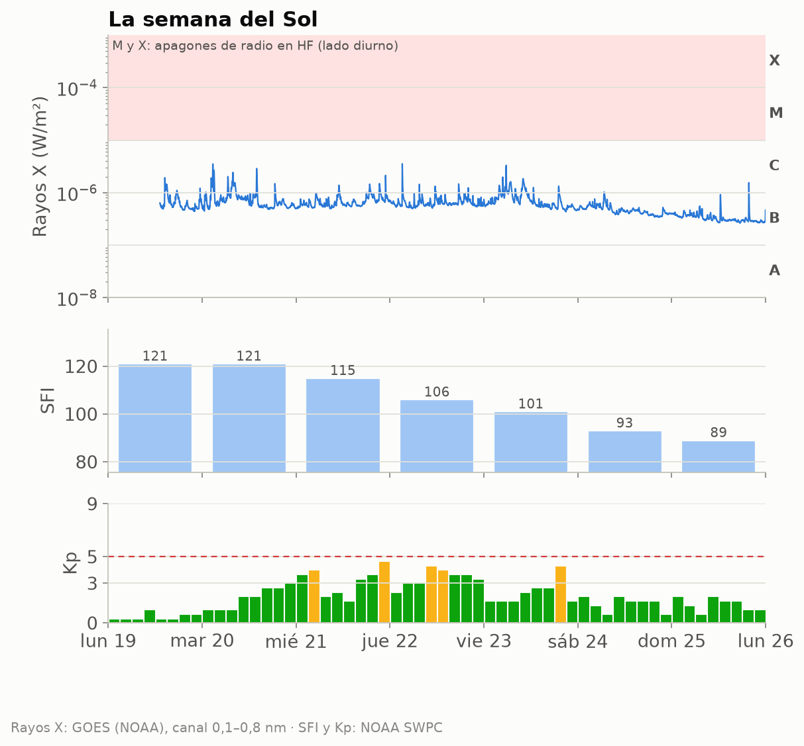
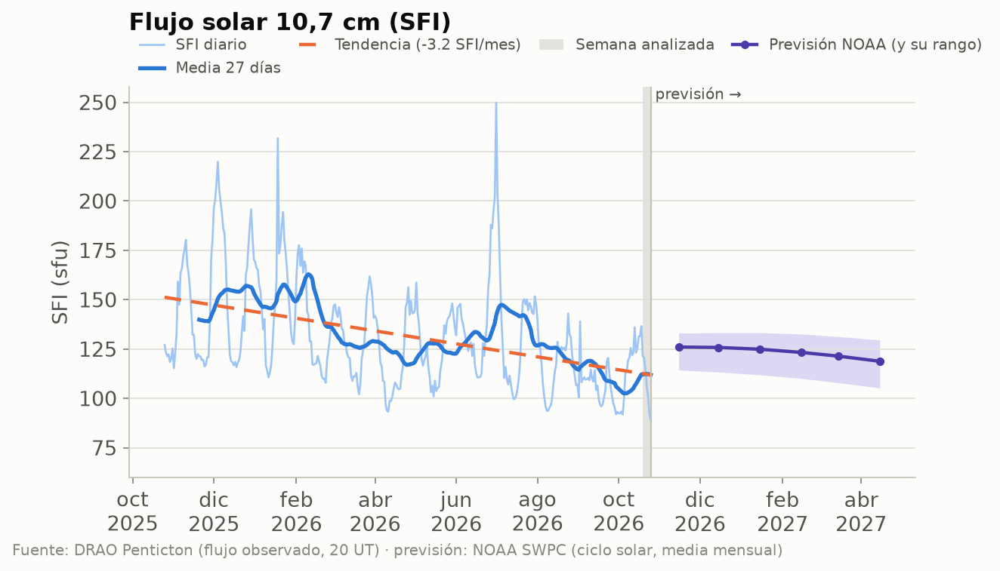
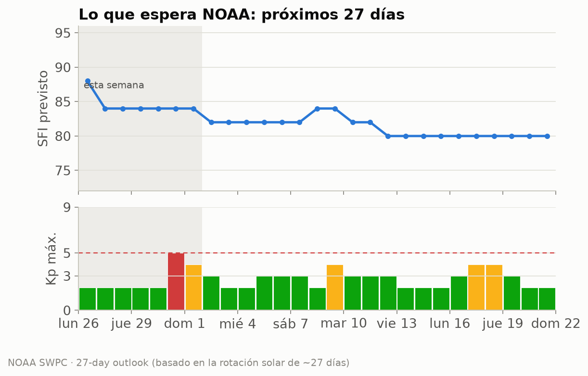
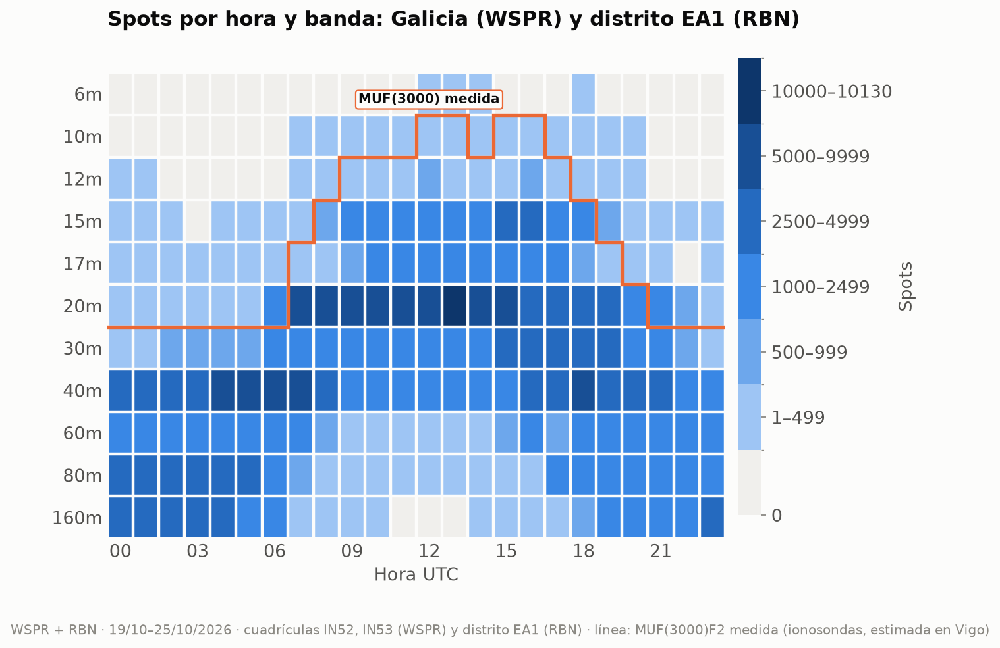
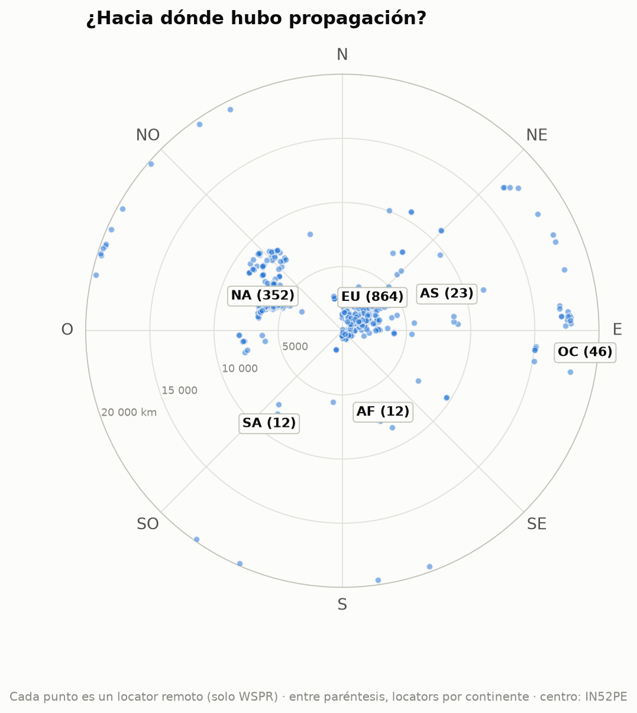
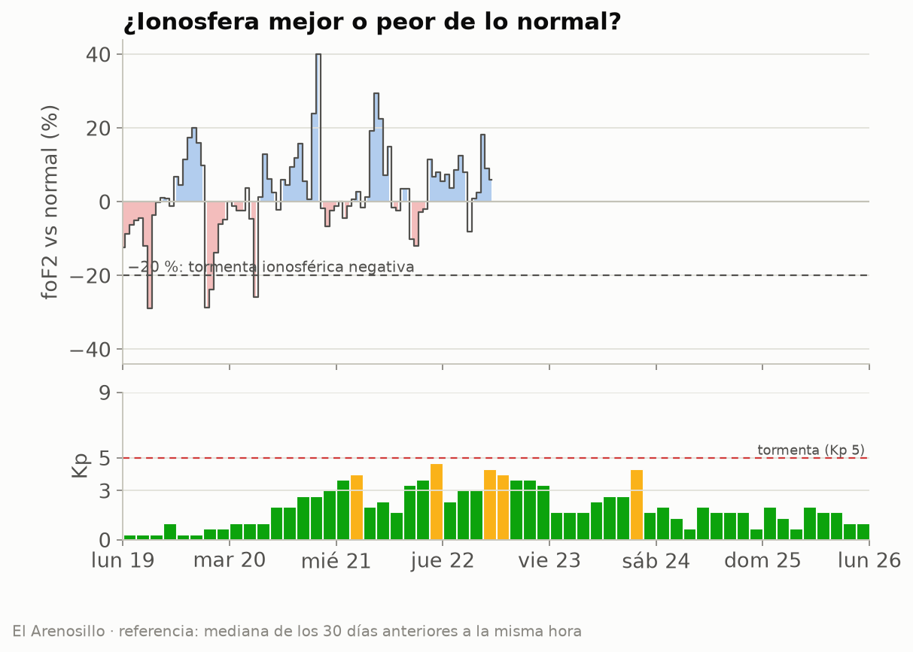
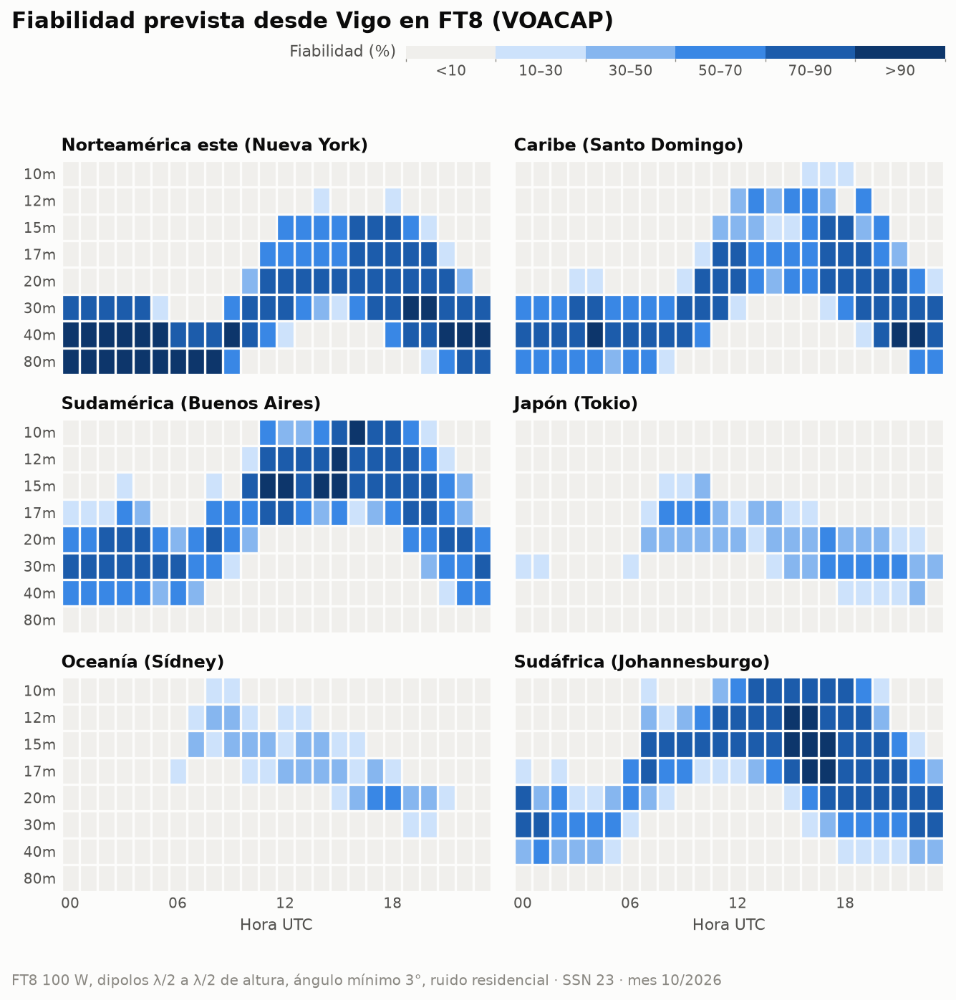
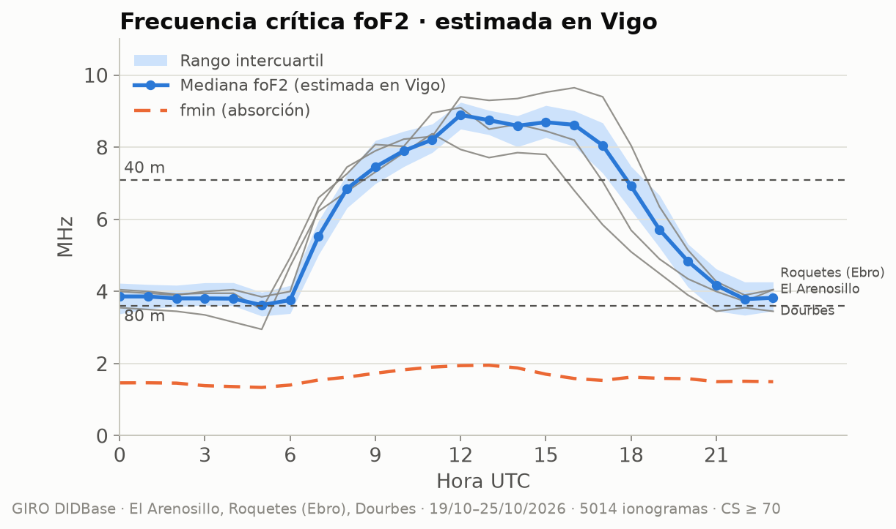

# Propagación HF/VHF desde Vigo · semana 2026-W44

**EA1RKV · Unión de Radioaficionados de Vigo-Val Miñor** · estación de referencia
Vigo (IN52PE) · semana analizada: 19 de octubre de 2026 – 25 de octubre de 2026 ·
previsión: lun 26/10 – dom 1/11

> Este informe combina **lo que dice la teoría** (índices solares, predicciones) con **lo que pasó
> de verdad** (spots reales desde Galicia). Todas las horas en UTC salvo que se indique lo contrario.

## 1. El Sol y el campo geomagnético

- **Flujo solar (SFI):** media **107**, máximo 121, mínimo 89 ·
  tendencia frente a la semana anterior: **a la baja (-18 %)** (media previa 130).
- **SSN efectivo aproximado:** ≈ **48** (SSN ≈ 1,14·SFI − 73,2) · número de manchas observado (media): 49.
- **Campo geomagnético:** 🟡 **inquieto** · Kp máximo **4,67** · Ap medio **10** (máx. 20) · 3 día(s) con Kp ≥ 4.
- **Fulguraciones:** 0 de clase X y 1 de clase M. Una fulguración fuerte en el lado diurno puede provocar un *apagón de radio* (absorción en la capa D) durante minutos u horas.

| Día | SFI | Manchas | Ap | Kp máx. | |
|---|---:|---:|---:|---:|:-:|
| lun 19/10 | 121 | 66 | 3 | 1,00 | 🟢 |
| mar 20/10 | 121 | 66 | 8 | 3,00 | 🟢 |
| mié 21/10 | 115 | 66 | 19 | 4,67 | 🟡 |
| jue 22/10 | 106 | 49 | 20 | 4,33 | 🟡 |
| vie 23/10 | 101 | 51 | 11 | 4,33 | 🟡 |
| sáb 24/10 | 93 | 25 | 5 | 2,00 | 🟢 |
| dom 25/10 | 89 | 22 | 5 | 2,00 | 🟢 |

_Semáforo Kp: 🟢 ≤ 3 tranquilo · 🟡 4 inquieto · 🔴 ≥ 5 tormenta._

_Cómo leerla, de arriba abajo. **Rayos X:** cada pico es una fulguración; si entra en la franja
rosa (clases M y X), en la cara iluminada de la Tierra la capa D absorbe la HF durante minutos u
horas (el famoso «apagón de radio»). Los huecos de la línea son cortes de datos: cerca de los
equinoccios el satélite pasa cada día un rato por la sombra de la Tierra. **SFI:** cuanto más alto, más arriba llega la MUF.
**Kp:** agitación del campo magnético cada 3 horas; las barras rojas son tormenta._

_Estamos en la fase descendente del ciclo 25: el SFI baja poco a poco, con altibajos de ~27 días
(la rotación del Sol). La línea discontinua naranja marca la tendencia del último año; a la
derecha, en violeta, la previsión mensual de NOAA con su rango de incertidumbre (zona sombreada)._

### ¿Qué viene? Previsión de la actividad solar

**Próximos 3 días** (NOAA, la previsión más fiable; emitida el lun 26/10 12:30 UTC):

| Día | Kp máx. previsto | | Prob. apagón de radio R1–R2 | Prob. apagón fuerte (R3+) |
|---|---:|:-:|---:|---:|
| lun 26/10 | 2,00 | 🟢 | 15 % | 1 % |
| mar 27/10 | 1,67 | 🟢 | 10 % | 1 % |
| mié 28/10 | 1,67 | 🟢 | 5 % | 1 % |

_R1–R2 = fulguración M (apagón menor o moderado en la cara diurna); R3+ = fulguración X._

**Esta semana:** SFI entre 84 y 88, Ap máximo 30 y
Kp máximo 5 (🔴 tormenta geomagnética (G1)); días con Kp ≥ 4 previstos:
sáb 31/10, dom 1/11.

**Hasta el sáb 21/11:** SFI entre 80 y 88; posible
agitación geomagnética (Kp ≥ 4) el sáb 31/10, dom 1/11, lun 9/11, mar 17/11, mié 18/11.
_Esta previsión se basa en que el Sol gira sobre sí mismo cada ~27 días: las regiones activas y
los agujeros coronales que vimos hace una rotación suelen «volver a asomarse». Por eso acierta
bastante con las tendencias, pero no puede anticipar una fulguración concreta._

**A largo plazo:** NOAA prevé para abril de 2027 un SFI medio mensual de
**119** (entre 105 y 130). Es decir, el ciclo 25 sigue
bajando: poco a poco, 10 m y 12 m abrirán menos días. **Ojo:** la media de los últimos
27 días (112) va **por debajo** del rango que NOAA preveía para este mes
(unos 126): el Sol se está apagando más
deprisa de lo esperado, y las bandas altas lo notarán.

## 2. Lo que pasó de verdad desde Galicia

Esta semana se registraron **343 054 spots**: 299 999 de WSPR con una
estación gallega en un extremo (5 estaciones en las cuadrículas IN52/IN53) y
43 055 de la Reverse Beacon Network en CW/RTTY con una estación del **distrito EA1** (el RBN
no da locator, así que no podemos separar Galicia de Asturias, Cantabria y Castilla y León).
Las bandas con más actividad fueron **20m** (85 530), **40m** (79 498), **30m** (40 570), **80m** (35 223), y la hora más movida, las **18 UTC**.

_Cómo leerlo: cada casilla es una hora UTC en una banda; cuanto más oscura, más spots. Fíjate en
cómo las bandas altas (10–15 m) se «encienden» con el Sol y las bajas (40–80 m) de noche._

_La línea naranja es la **MUF(3000)F2 medida** por las ionosondas: por debajo de ella, la teoría dice
que la banda abre para un salto de 3 000 km. Si los spots siguen la línea, teoría y realidad coinciden._

### DX de la semana por banda

| Banda | Distancia | Estación gallega (WSPR) | Corresponsal | Locator | Continente | Cuándo | SNR |
|---|---:|---|---|---|---|---|---:|
| 160m | 6 227 km | EB1A | WA4LDU (oyó a Galicia) | EM93ix | Norteamérica | mié 21/10 05:12 UTC | -25 dB |
| 80m | 17 045 km | EB1A | VK5ARG (oyó a Galicia) | PF95ht | Oceanía | mié 21/10 20:00 UTC | -24 dB |
| 60m | 19 820 km | EB1A | ZL2005SWL (oyó a Galicia) | RE68mx | Oceanía | vie 23/10 07:04 UTC | -25 dB |
| 40m | 19 820 km | EB1A | ZL2005SWL (oyó a Galicia) | RE68mx | Oceanía | mar 20/10 05:48 UTC | -24 dB |
| 30m | 19 820 km | EB1A | ZL2005SWL (oyó a Galicia) | RE68mx | Oceanía | sáb 24/10 18:06 UTC | -26 dB |
| 20m | 19 828 km | EB1A | ZL3TKI (oyó a Galicia) | RE66hk | Oceanía | vie 23/10 09:56 UTC | -28 dB |
| 17m | 18 000 km | EB1A | VK2EFM (oyó a Galicia) | QF56oq | Oceanía | mié 21/10 14:44 UTC | -21 dB |
| 15m | 17 745 km | EB1A | VK5WA/2 (oyó a Galicia) | QG50nf | Oceanía | vie 23/10 10:48 UTC | -26 dB |
| 12m | 17 045 km | EB1A | VK5ARG (oyó a Galicia) | PF95ht | Oceanía | lun 19/10 08:02 UTC | -27 dB |

_Distancias de círculo máximo medidas desde IN52PE (WSPR)._

### Rutas por continente

Spots de WSPR (Galicia) y RBN (distrito EA1) juntos, por continente del corresponsal:

| Continente | Spots | 160m | 80m | 60m | 40m | 30m | 20m | 17m | 15m | 12m | 10m | 6m | 
|---|---:|---:|---:|---:|---:|---:|---:|---:|---:|---:|---:|---:|
| Europa | **290 875** | 32590 | 32707 | 23155 | 67243 | 35165 | 71367 | 11804 | 14451 | 2276 | 107 | 10 | 
| Norteamérica | **40 865** | 191 | 1868 | 3395 | 10189 | 3634 | 11667 | 2392 | 5339 | 2087 | 103 | · | 
| África | **6 834** | 1359 | 640 | 622 | 1074 | 859 | 821 | 559 | 712 | 182 | 6 | · | 
| Oceanía | **2 735** | · | 4 | 8 | 668 | 693 | 1193 | 82 | 80 | 7 | · | · | 
| Asia | **995** | 2 | 4 | · | 211 | 145 | 394 | 51 | 135 | 38 | 15 | · | 
| Sudamérica | **750** | · | · | · | 113 | 74 | 88 | 81 | 276 | 43 | 75 | · | 

_Mapa centrado en Vigo: el ángulo es el rumbo al que apuntaría tu antena y la distancia al centro,
los kilómetros. Solo WSPR, porque el RBN no da locator: cada punto es un locator distinto
(1 309 en total) y la cifra entre paréntesis es cuántos hay de cada continente. Por eso no
coincide con los spots de la tabla, que suman todos los spots de WSPR y RBN._

### La ionosfera medida

Datos de las digisondas de **El Arenosillo** (37,1° N), **Roquetes (Ebro)** (40,8° N), **Dourbes** (50,1° N).
Solo usamos ionogramas con confianza de autoescalado ≥ 70 % y descartamos los valores
que se salen de lo que marcan sus vecinos (los errores típicos del escalado automático).

#### ¿Mejor o peor de lo normal?

La foF2 se movió en torno a lo habitual (media semanal 2 %; el peor día, el
lun 19/10, con -4 %). Sin tormentas ionosféricas negativas.

_Se compara cada medida de El Arenosillo con la mediana de los 30 días anteriores a la misma hora.
Por debajo del −20 % hablamos de tormenta ionosférica negativa._

#### ¿Hubo esporádica E esta semana?

**Algo:** la foEs pasó de 5,6 MHz, lo bastante para aperturas cortas en 10 m, pero no llegó a 6 m.

| Ionosonda | Día | Desde | Hasta (UTC) | foEs máx. | MUF Es (~1 800 km) | Banda | Spots WSPR |
|---|---|---|---|---:|---:|---|---:|
| Dourbes | lun 19/10 | 10:10 | 10:10 | 6,2 MHz | 31 MHz | 10m | 0 |
| Dourbes | lun 19/10 | 12:55 | 13:00 | 6,3 MHz | 32 MHz | 10m | 0 |
| Roquetes (Ebro) | lun 19/10 | 15:00 | 15:15 | 6,0 MHz | 30 MHz | 10m | 0 |
| Dourbes | mié 21/10 | 11:25 | 11:50 | 6,4 MHz | 32 MHz | 10m | 0 |
| Roquetes (Ebro) | sáb 24/10 | 11:15 | 11:35 | 5,6 MHz | 28 MHz | 10m | 0 |

_La MUF de la Es para un salto de 1 500–2 000 km es unas 5 veces la foEs. «Spots WSPR»: spots de esa
banda a 800–2 500 km desde Galicia durante el episodio._

#### Teoría frente a realidad

Comparamos, hora a hora, lo que dice la MUF(3000) medida con lo que se oyó de verdad a 2 000–4 000 km
(un salto de F2) en 20m, 17m, 15m, 12m. **Coinciden en el 84 %** de las
96 casillas hora × banda. En 2 la MUF decía «abierta» pero
no hubo spots (poca actividad WSPR en esa banda y hora, o absorción). En 13
hubo spots aunque la MUF típica no llegaba, sobre todo en 20m y 17m: días mejores
que la mediana o esporádica E. La línea naranja del mapa de calor muestra lo mismo de un vistazo.

#### Notas curiosas (El Arenosillo)

- La capa F2 tuvo su pico a **250 km** de altura a mediodía y a 341 km de noche.
- La capa F1 apareció de día, con foF1 de hasta 5,2 MHz (10:15 UTC).
- **Spread-F:** se vio en 1 noche(s) (5 h en total). Son irregularidades de la capa F que en la radio se notan como *flutter* y ecos, sobre todo en 40–80 m de madrugada.

## 3. Previsión para la semana (lun 26/10 – dom 1/11)

### DX: fiabilidad prevista (VOACAP)

**En FT8** (el modo más usado, y el más parecido a los spots WSPR/RBN de la sección 2): bandas con
fiabilidad media ≥ 50 % por franja horaria (UTC), la mejor primero. En cursiva, la mejor banda
cuando ninguna llega al 50 % (apertura posible pero poco fiable):

| Destino | km | Rumbo | 00–04 | 04–08 | 08–12 | 12–16 | 16–20 | 20–24 | 
|---|---:|---:|---|---|---|---|---|---|
| Norteamérica este (Nueva York) | 5 307 | 291° | 80m, 40m, 30m | 80m, 40m | 40m, 30m | 20m, 17m, 15m | 20m, 30m, 17m | 40m, 30m, 80m | 
| Caribe (Santo Domingo) | 6 288 | 265° | 40m, 30m, 80m | 40m, 30m, 80m | 30m, 40m | 17m, 20m | 20m, 17m, 15m | 40m, 30m, 20m | 
| Sudamérica (Buenos Aires) | 9 922 | 219° | 30m, 20m, 40m | 30m, 20m, 40m | 17m | 15m, 12m, 17m | 12m, 15m, 10m | 20m, 30m | 
| Japón (Tokio) | 10 780 | 25° | — | — | 17m | _20m (38 %)_ | 30m | 30m | 
| Oceanía (Sídney) | 18 035 | 69° | — | — | _15m (36 %)_ | _17m (33 %)_ | _20m (46 %)_ | — | 
| Sudáfrica (Johannesburgo) | 8 489 | 146° | 30m, 20m | _30m (36 %)_ | 15m | 12m, 15m, 10m | 15m, 12m, 17m | 20m, 30m, 17m | 

**En CW** (a oído hace falta unos 14 dB más de señal que en FT8, así que se abren menos bandas):

| Destino | 00–04 | 04–08 | 08–12 | 12–16 | 16–20 | 20–24 | 
|---|---|---|---|---|---|---|
| Norteamérica este (Nueva York) | 40m, 30m, 80m | 40m, 80m | _40m (48 %)_ | _20m (46 %)_ | 20m | 40m, 30m | 
| Caribe (Santo Domingo) | 40m | 40m | _30m (32 %)_ | _17m (29 %)_ | _17m (46 %)_ | 30m | 
| Sudamérica (Buenos Aires) | _30m (45 %)_ | _30m (40 %)_ | _15m (28 %)_ | 12m, 15m | 12m, 10m | _20m (38 %)_ | 
| Japón (Tokio) | — | — | _17m (27 %)_ | — | _30m (21 %)_ | _30m (27 %)_ | 
| Oceanía (Sídney) | — | — | — | — | _20m (21 %)_ | — | 
| Sudáfrica (Johannesburgo) | _30m (36 %)_ | — | _15m (48 %)_ | 10m | 12m, 15m, 10m | _20m (45 %)_ | 

_Supuestos: 100 W, dipolos de media onda a media longitud de onda de altura en los dos extremos,
ángulo de salida mínimo de 3° y ruido residencial. SSN usado: **23** (SSN efectivo del SFI previsto (85)).
En SSB hacen falta ~30 dB más que en FT8. VOACAP describe el promedio mensual: un día concreto puede
ir mucho mejor o peor._

### NVIS y contactos regionales (80 y 40 m)

Combinando El Arenosillo, Roquetes (Ebro), Dourbes y llevándolas a la latitud y la hora local de Vigo
(El Arenosillo sola, 5° más al sur, resulta algo optimista), la **foF2 mediana estimada en Vigo fue de
5,6 MHz** la
semana pasada: de 3,6 MHz de madrugada a 8,9 MHz hacia las
12 UTC. El pico de la
capa F2 estuvo de mediana a 263 km.

| Trayecto | sec φ | 80 m abierta | 40 m abierta | MUF (mín.–máx.) |
|---|---:|---|---|---|
| NVIS (Galicia, < 200 km) | 1,00 | 07–22 UTC | 10–18 UTC | 3,6–8,9 MHz |
| Vigo – Madrid (~460 km) | 1,32 | todo el día | 08–19 UTC | 4,6–12,2 MHz |
| Vigo – Barcelona (~900 km) | 1,89 | 15–09 UTC · _absorción: 09–15 UTC_ | 07–21 UTC | 6,2–17,8 MHz |

**A 3 000 km** (un salto de F2, p. ej. Canarias–Escandinavia): la **MUF(3000)F2 medida** fue de
10,8 a 29,7 MHz (máxima hacia las 12 UTC).
20m: 07–20 UTC · 17m: 08–19 UTC · 15m: 08–18 UTC · 12m: 11–18 UTC · 10m: cerrada.

> **¿Por qué importa foF2?** Es la frecuencia más alta que la capa F2 devuelve a tierra cuando
> la señal sube en vertical. En NVIS (*Near Vertical Incidence Skywave*, antenas bajas que radian
> hacia arriba) solo rebotan las frecuencias **por debajo de foF2**: si foF2 cae por debajo de
> 7,1 MHz, los 40 m «saltan» Galicia y hay que bajar a 80 m. Para trayectos más largos la señal
> llega inclinada y la capa aguanta más: la MUF de un salto es aproximadamente
> **foF2 · sec(φ)**, donde φ es el ángulo de incidencia en la ionosfera, calculado con la altura
> real del pico (hmF2) que mide la ionosonda. Para 3 000 km usamos directamente la MUF(3000)F2 que
> publica la digisonda, que ya tiene en cuenta la curvatura de la Tierra.
>
> **¿Y por abajo?** La capa D absorbe las frecuencias bajas de día. La **fmin** (frecuencia más
> baja del ionograma) sube a mediodía por esa absorción: la usamos para estimar la LUF
> (≈ fmin · √sec φ en la capa D). Una banda está «abierta» si la MUF la supera con un 10 % de
> margen y la LUF queda por debajo; «absorción» son las horas en que la MUF la deja pasar pero la
> capa D la cierra.

### Línea gris

El jue 29/10, en Vigo amanece a las **07:03 UTC** y anochece a las **17:32 UTC**.
Durante el crepúsculo la absorción de la capa D desaparece antes de que se deshaga la capa F: es
el momento de buscar DX en 160, 80 y 40 m a lo largo del terminador.

| Destino | Orto DX | Ocaso DX | Terminador común (±45 min) | Noche en los dos extremos |
|---|---|---|---|---|
| Norteamérica este (Nueva York) | 11:22 | 21:55 | — | 21:57–07:03 |
| Caribe (Santo Domingo) | 10:38 | 22:08 | — | 22:08–07:03 |
| Sudamérica (Buenos Aires) | 08:54 | 22:20 | — | 22:19–07:03 |
| Japón (Tokio) | 20:59 | 07:49 | 07:04–07:48 UTC (orto Vigo / ocaso DX) | 17:32–21:00 |
| Oceanía (Sídney) | 18:58 | 08:20 | 07:35–07:48 UTC (orto Vigo / ocaso DX) | 17:32–18:57 |
| Sudáfrica (Johannesburgo) | 03:20 | 16:22 | 16:47–17:07 UTC (ocaso Vigo / ocaso DX) | 17:33–03:20 |

_El «terminador común» es la línea gris propiamente dicha (amanecer o anochecer a la vez en los dos
extremos). La «noche en los dos extremos» es la ventana para 160 y 80 m, y a menudo para 40 m._

## 4. Agenda y efemérides

### Concursos del fin de semana

| Concurso | Empieza (UTC) | Termina (UTC) | Horas |
|---|---|---|---:|
| [K1USN Slow Speed Test](https://www.contestcalendar.com/weeklycontdetails.php?ref=003ftbhl) | vie 30/10 20:00 | vie 30/10 21:00 | 1 |
| [ARRL EME Contest](https://www.contestcalendar.com/weeklycontdetails.php?ref=003drkyp) | sáb 31/10 00:00 | dom 1/11 23:59 | 48 |
| [UK/EI DX Contest, SSB](https://www.contestcalendar.com/weeklycontdetails.php?ref=0039u4ic) | sáb 31/10 12:00 | dom 1/11 12:00 | 24 |
| [Russian WW MultiMode Contest](https://www.contestcalendar.com/weeklycontdetails.php?ref=003b7f6m) | sáb 31/10 12:00 | dom 1/11 11:59 | 24 |
| [North American SSB Sprint Contest](https://www.contestcalendar.com/weeklycontdetails.php?ref=003gebbm) | dom 1/11 00:00 | dom 1/11 04:00 | 4 |
| [EANET Sprint](https://www.contestcalendar.com/weeklycontdetails.php?ref=003gclty) | dom 1/11 08:00 | dom 1/11 12:00 | 4 |
| [Classic Exchange, CW](https://www.contestcalendar.com/weeklycontdetails.php?ref=003fhqod) | dom 1/11 14:00 | mié 4/11 08:00 | 66 |
| [High Speed Club CW Contest](https://www.contestcalendar.com/weeklycontdetails.php?ref=003gd11k) | dom 1/11 14:00 | dom 1/11 17:00 | 3 |
| [Real Time Contest](https://www.contestcalendar.com/weeklycontdetails.php?ref=003fnbim) | dom 1/11 16:00 | dom 1/11 20:00 | 4 |

### Lluvias de meteoros (meteor scatter en 6 m y 2 m)

- **Oriónidas** — máximo mié 21/10 (hace 5 días), THZ ≈ 20 · _activa esta semana_.
- **Leónidas** — máximo mar 17/11 (dentro de 22 días), THZ ≈ 15.

_Consejo: el meteor scatter funciona mejor al amanecer local, cuando la Tierra «barre» los
meteoros de frente. Modos: MSK144 (6 m/2 m) con WSJT-X._

### Pases de satélites desde Vigo

Los mejores pases (elevación máxima ≥ 30°) de cada satélite:

| Satélite | Día | AOS (UTC) | LOS (UTC) | Hora local | Elev. máx. | Min |
|---|---|---|---|---|---:|---:|
| ISS | lun 26/10 | 02:05 | 02:15 | 03:05 | 86° | 11 |
| FO-29 | lun 26/10 | 06:01 | 06:18 | 07:01 | 70° | 17 |
| SO-50 | lun 26/10 | 14:10 | 14:24 | 15:10 | 66° | 14 |
| AO-123 | mar 27/10 | 08:52 | 09:03 | 09:52 | 87° | 11 |
| AO-27 | mar 27/10 | 10:56 | 11:11 | 11:56 | 74° | 15 |
| AO-7 | mar 27/10 | 18:07 | 18:29 | 19:07 | 81° | 22 |
| AO-123 | mar 27/10 | 21:46 | 21:57 | 22:46 | 83° | 11 |
| RS-44 | mié 28/10 | 02:09 | 02:30 | 03:09 | 82° | 21 |
| FO-29 | mié 28/10 | 05:56 | 06:12 | 06:56 | 64° | 17 |
| SO-50 | jue 29/10 | 13:22 | 13:36 | 14:22 | 66° | 14 |
| RS-44 | jue 29/10 | 15:10 | 15:33 | 16:10 | 80° | 23 |
| ISS | vie 30/10 | 00:31 | 00:42 | 01:31 | 86° | 11 |
| AO-7 | vie 30/10 | 07:53 | 08:16 | 08:53 | 82° | 22 |
| AO-27 | vie 30/10 | 11:05 | 11:20 | 12:05 | 89° | 15 |
| AO-123 | vie 30/10 | 21:38 | 21:49 | 22:38 | 74° | 11 |
| SO-50 | sáb 31/10 | 03:48 | 04:02 | 04:48 | 66° | 14 |
| FO-29 | sáb 31/10 | 19:33 | 19:49 | 20:33 | 67° | 16 |
| AO-27 | sáb 31/10 | 21:54 | 22:09 | 22:54 | 75° | 15 |
| RS-44 | dom 1/11 | 01:51 | 02:11 | 02:51 | 89° | 20 |
| ISS | dom 1/11 | 05:25 | 05:36 | 06:25 | 79° | 11 |
| AO-7 | dom 1/11 | 07:46 | 08:09 | 08:46 | 89° | 22 |

## 5. Comentario del club

<!-- COMENTARIO -->
> PENDIENTE: un socio debe escribir aquí su comentario (qué trabajó, qué oyó, qué recomienda
> para la semana). **El informe no se publica sin este párrafo.**
<!-- /COMENTARIO -->

---

### Fuentes

- NOAA SWPC — índices solares y geomagnéticos diarios, flujo de rayos X y fulguraciones de GOES, previsión a 3 y 27 días y previsión del ciclo solar (https://www.swpc.noaa.gov/)
- NRC Canada / DRAO Penticton — histórico diario del flujo F10.7 (https://www.spaceweather.gc.ca/)
- WSPRnet vía wspr.live (https://wspr.live/)
- Reverse Beacon Network (https://www.reversebeacon.net/)
- GIRO / DIDBase, Lowell GIRO Data Center (https://giro.uml.edu/), datos CC-BY-NC-SA 4.0 de las digisondas de El Arenosillo (INTA), Roquetes (Observatori de l'Ebre), Dourbes (RMI Bélgica)
- VOACAP (voacapl, port para Linux de J. Watson; https://github.com/jawatson/voacapl)
- WA7BNM Contest Calendar (https://www.contestcalendar.com/)
- International Meteor Organization — calendario de lluvias (https://www.imo.net/)
- CelesTrak — TLE de satélites de radioaficionado (https://celestrak.org/)
- Cálculos propios: SSN efectivo, distancias de círculo máximo, MUF por ley de la secante y
  orto/ocaso (algoritmo de NOAA).

Borrador generado automáticamente el 2026-10-26 13:13 UTC por el script del radioclub
EA1RKV. Las secciones sin datos indican que la fuente no respondió esta semana.
