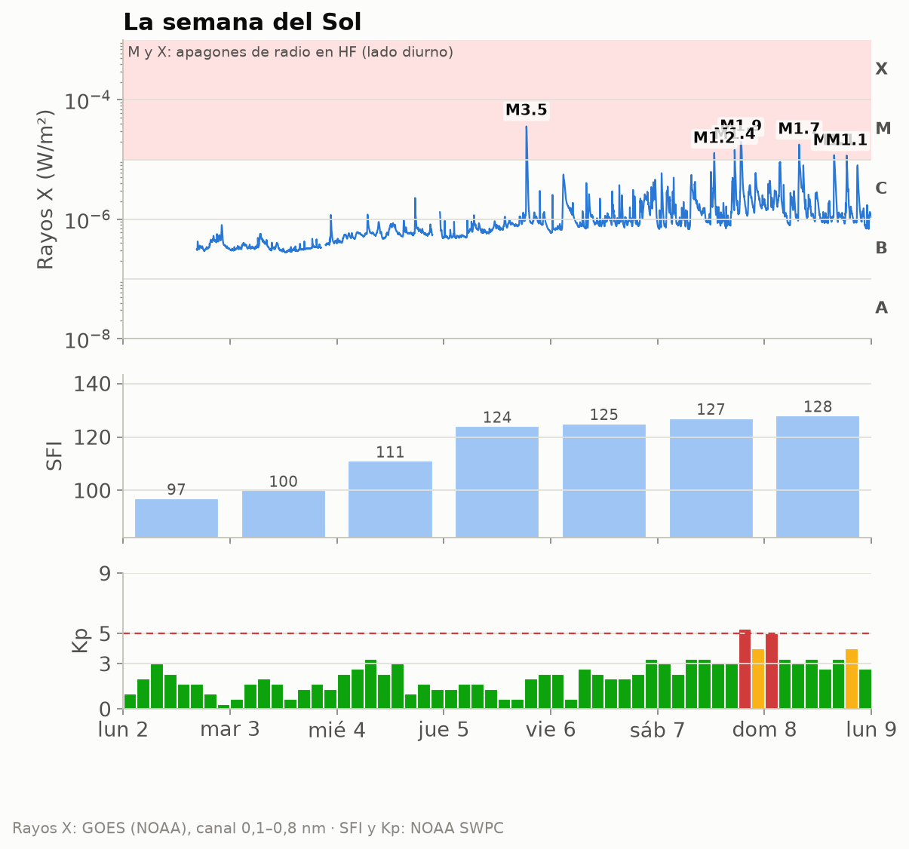
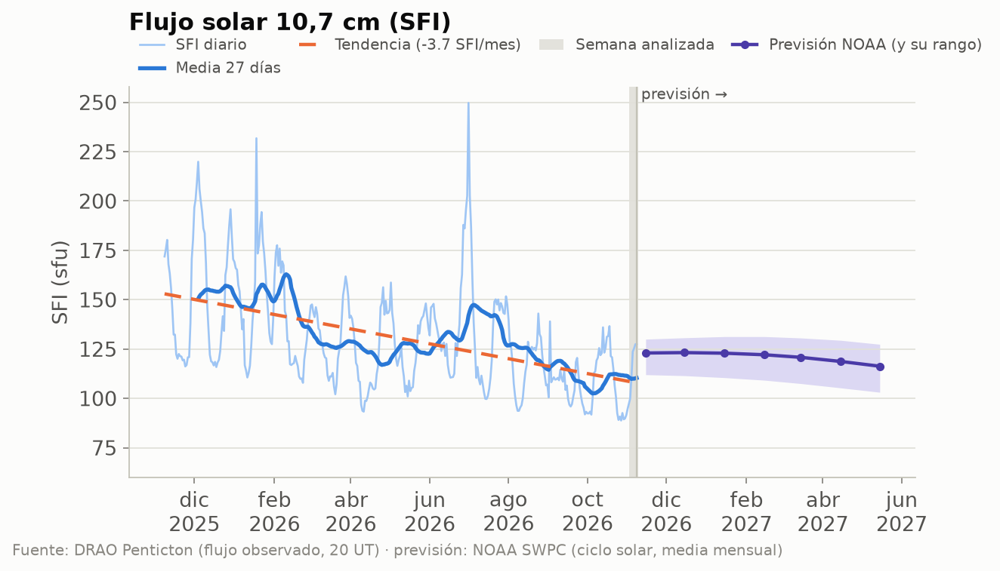
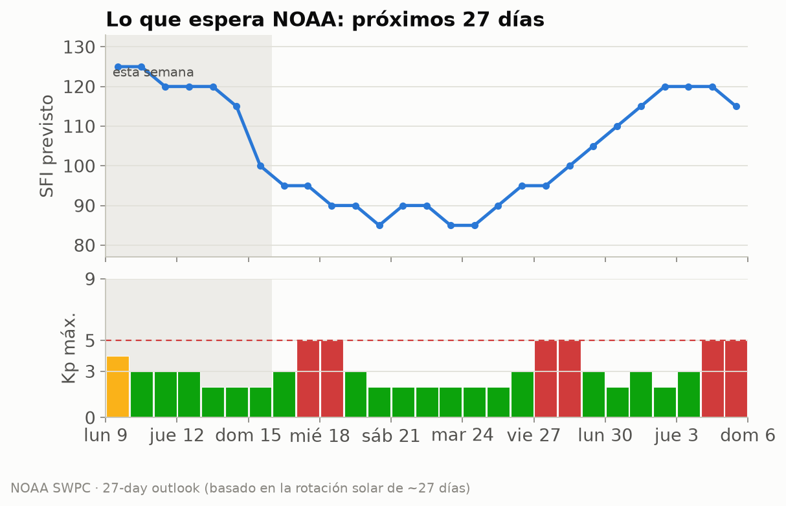
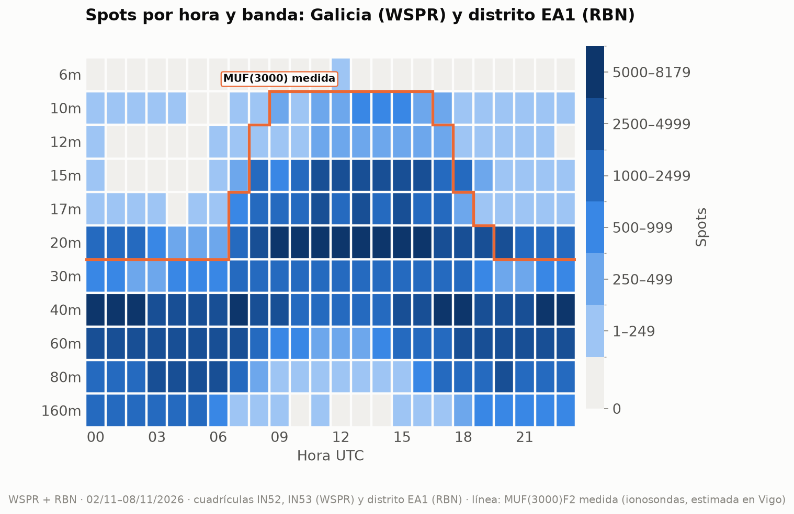
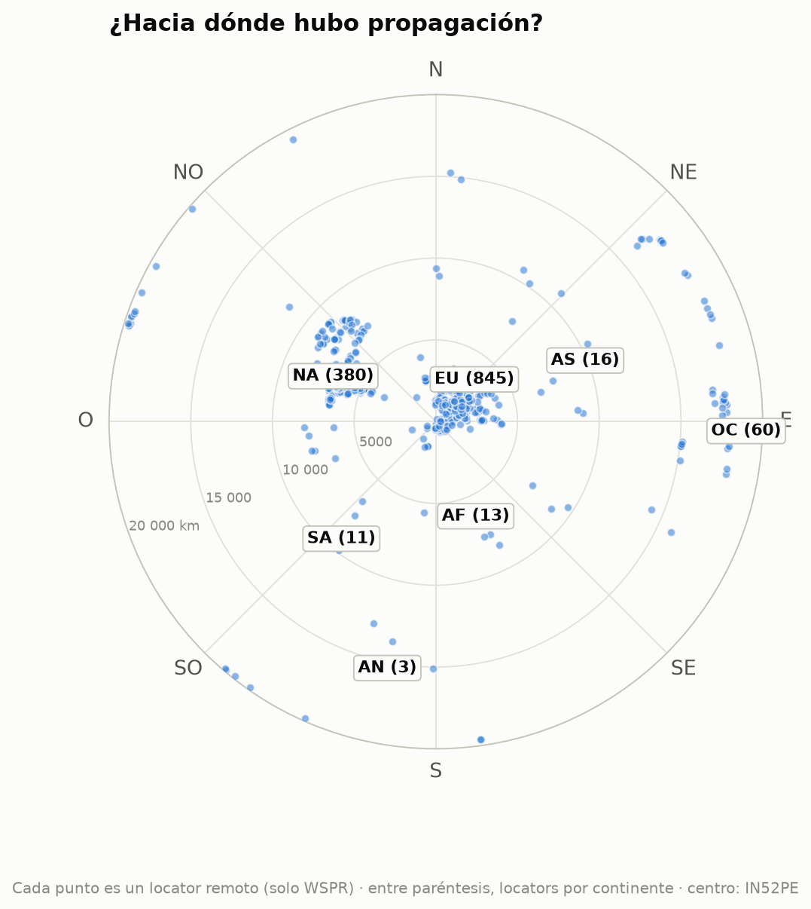
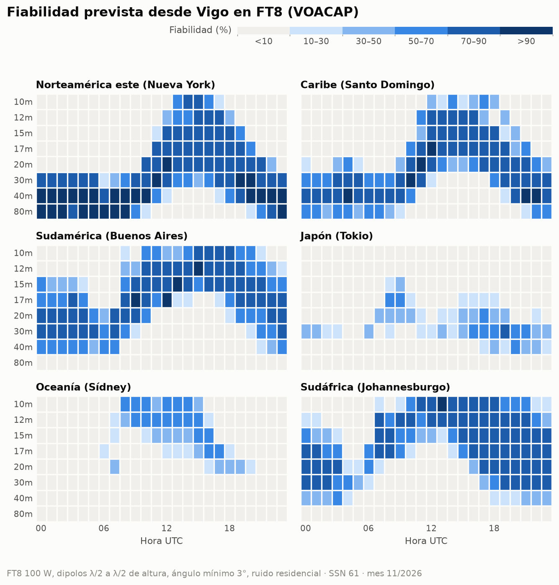
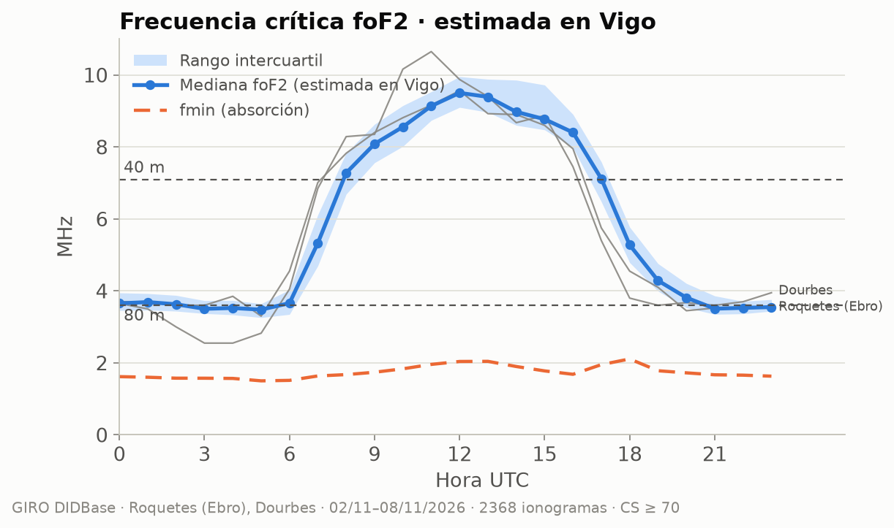

# Propagación HF/VHF desde Vigo · semana 2026-W46

**EA1RKV · Unión de Radioaficionados de Vigo-Val Miñor** · estación de referencia
Vigo (IN52PE) · semana analizada: 2 de noviembre de 2026 – 8 de noviembre de 2026 ·
previsión: lun 9/11 – dom 15/11

> Este informe combina **lo que dice la teoría** (índices solares, predicciones) con **lo que pasó
> de verdad** (spots reales desde Galicia). Todas las horas en UTC salvo que se indique lo contrario.

## 1. El Sol y el campo geomagnético

- **Flujo solar (SFI):** media **116**, máximo 128, mínimo 97 ·
  tendencia frente a la semana anterior: **al alza (+27 %)** (media previa 91).
- **SSN efectivo aproximado:** ≈ **59** (SSN ≈ 1,14·SFI − 73,2) · número de manchas observado (media): 70.
- **Campo geomagnético:** 🔴 **tormenta geomagnética (G1)** · Kp máximo **5,33** · Ap medio **15** (máx. 22) · 2 día(s) con Kp ≥ 4.
- **Fulguraciones:** 0 de clase X y 7 de clase M — la mayor, **M3.5** (jue 5/11 18:33 UTC). Una fulguración fuerte en el lado diurno puede provocar un *apagón de radio* (absorción en la capa D) durante minutos u horas.

| Día | SFI | Manchas | Ap | Kp máx. | |
|---|---:|---:|---:|---:|:-:|
| lun 2/11 | 97 | 37 | 7 | 3,00 | 🟢 |
| mar 3/11 | 100 | 41 | — | 2,00 | 🟢 |
| mié 4/11 | 111 | 64 | — | 3,33 | 🟢 |
| jue 5/11 | 124 | 89 | — | 2,33 | 🟢 |
| vie 6/11 | 125 | 91 | 9 | 3,33 | 🟢 |
| sáb 7/11 | 127 | 93 | 22 | 5,33 | 🔴 |
| dom 8/11 | 128 | 72 | 21 | 5,00 | 🔴 |

_Semáforo Kp: 🟢 ≤ 3 tranquilo · 🟡 4 inquieto · 🔴 ≥ 5 tormenta._

_Cómo leerla, de arriba abajo. **Rayos X:** cada pico es una fulguración; si entra en la franja
rosa (clases M y X), en la cara iluminada de la Tierra la capa D absorbe la HF durante minutos u
horas (el famoso «apagón de radio»). Los huecos de la línea son cortes de datos: cerca de los
equinoccios el satélite pasa cada día un rato por la sombra de la Tierra. **SFI:** cuanto más alto, más arriba llega la MUF.
**Kp:** agitación del campo magnético cada 3 horas; las barras rojas son tormenta._

_Estamos en la fase descendente del ciclo 25: el SFI baja poco a poco, con altibajos de ~27 días
(la rotación del Sol). La línea discontinua naranja marca la tendencia del último año; a la
derecha, en violeta, la previsión mensual de NOAA con su rango de incertidumbre (zona sombreada)._

### ¿Qué viene? Previsión de la actividad solar

**Próximos 3 días** (NOAA, la previsión más fiable; emitida el lun 9/11 12:30 UTC):

| Día | Kp máx. previsto | | Prob. apagón de radio R1–R2 | Prob. apagón fuerte (R3+) |
|---|---:|:-:|---:|---:|
| lun 9/11 | 4,67 | 🟡 | 60 % | 15 % |
| mar 10/11 | 3,67 | 🟢 | 60 % | 15 % |
| mié 11/11 | 2,67 | 🟢 | 60 % | 15 % |

_R1–R2 = fulguración M (apagón menor o moderado en la cara diurna); R3+ = fulguración X._

**Esta semana:** SFI entre 100 y 125, Ap máximo 15 y
Kp máximo 4 (🟡 inquieto); días con Kp ≥ 4 previstos:
lun 9/11.

**Hasta el sáb 5/12:** SFI entre 85 y 125; posible
agitación geomagnética (Kp ≥ 4) el lun 9/11, mar 17/11, mié 18/11, vie 27/11, sáb 28/11, vie 4/12, sáb 5/12.
_Esta previsión se basa en que el Sol gira sobre sí mismo cada ~27 días: las regiones activas y
los agujeros coronales que vimos hace una rotación suelen «volver a asomarse». Por eso acierta
bastante con las tendencias, pero no puede anticipar una fulguración concreta._

**A largo plazo:** NOAA prevé para mayo de 2027 un SFI medio mensual de
**116** (entre 103 y 127). Es decir, el ciclo 25 sigue
bajando: poco a poco, 10 m y 12 m abrirán menos días. **Ojo:** la media de los últimos
27 días (110) va **por debajo** del rango que NOAA preveía para este mes
(unos 123): el Sol se está apagando más
deprisa de lo esperado, y las bandas altas lo notarán.

## 2. Lo que pasó de verdad desde Galicia

Esta semana se registraron **380 736 spots**: 295 736 de WSPR con una
estación gallega en un extremo (5 estaciones en las cuadrículas IN52/IN53) y
85 000 de la Reverse Beacon Network en CW/RTTY con una estación del **distrito EA1** (el RBN
no da locator, así que no podemos separar Galicia de Asturias, Cantabria y Castilla y León).
Las bandas con más actividad fueron **40m** (93 709), **20m** (91 915), **60m** (57 305), **80m** (34 040), y la hora más movida, las **15 UTC**.

_Cómo leerlo: cada casilla es una hora UTC en una banda; cuanto más oscura, más spots. Fíjate en
cómo las bandas altas (10–15 m) se «encienden» con el Sol y las bajas (40–80 m) de noche._

_La línea naranja es la **MUF(3000)F2 medida** por las ionosondas: por debajo de ella, la teoría dice
que la banda abre para un salto de 3 000 km. Si los spots siguen la línea, teoría y realidad coinciden._

### DX de la semana por banda

| Banda | Distancia | Estación gallega (WSPR) | Corresponsal | Locator | Continente | Cuándo | SNR |
|---|---:|---|---|---|---|---|---:|
| 160m | 5 992 km | EB1A | KX4AZ/T (oyó a Galicia) | EN74gc | Norteamérica | mié 4/11 04:48 UTC | -26 dB |
| 80m | 17 045 km | EB1A | VK5ARG (oyó a Galicia) | PF95ht | Oceanía | mié 4/11 19:48 UTC | -26 dB |
| 60m | 17 045 km | EB1A | VK5ARG (oyó a Galicia) | PF95ht | Oceanía | jue 5/11 19:30 UTC | -25 dB |
| 40m | 19 869 km | EB1A | ZL3RCK (oyó a Galicia) | RE66ft | Oceanía | vie 6/11 05:36 UTC | -17 dB |
| 30m | 19 831 km | EB1A | ZL3AB (oyó a Galicia) | RE66im | Oceanía | jue 5/11 19:04 UTC | -25 dB |
| 20m | 19 849 km | EB1A | ZL3AX (oyó a Galicia) | RE66hq | Oceanía | sáb 7/11 04:44 UTC | -8 dB |
| 17m | 18 000 km | EB1A | VK2EFM (oyó a Galicia) | QF56oq | Oceanía | vie 6/11 12:38 UTC | -27 dB |
| 15m | 19 820 km | EB1A | ZL2005SWL (oyó a Galicia) | RE68mx | Oceanía | sáb 7/11 13:18 UTC | -26 dB |
| 12m | 15 116 km | EB1A | VK6XT (oyó a Galicia) | OF88ji | Oceanía | lun 2/11 07:24 UTC | -27 dB |

_Distancias de círculo máximo medidas desde IN52PE (WSPR)._

### Rutas por continente

Spots de WSPR (Galicia) y RBN (distrito EA1) juntos, por continente del corresponsal:

| Continente | Spots | 160m | 80m | 60m | 40m | 30m | 20m | 17m | 15m | 12m | 10m | 6m | 
|---|---:|---:|---:|---:|---:|---:|---:|---:|---:|---:|---:|---:|
| Europa | **298 716** | 14280 | 28307 | 45495 | 77129 | 23288 | 64582 | 19129 | 22202 | 1817 | 2486 | 1 | 
| Norteamérica | **74 141** | 86 | 5344 | 11130 | 14927 | 1026 | 25388 | 3184 | 10005 | 1418 | 1633 | · | 
| África | **4 671** | 418 | 351 | 671 | 918 | 447 | 720 | 343 | 465 | 185 | 153 | · | 
| Oceanía | **1 693** | · | 16 | 9 | 370 | 269 | 837 | 118 | 68 | 5 | 1 | · | 
| Asia | **1 074** | · | 22 | · | 321 | 29 | 311 | 86 | 193 | 31 | 81 | · | 
| Sudamérica | **438** | 1 | · | · | 44 | 3 | 74 | 5 | 130 | 25 | 156 | · | 
| Antártida | **3** | · | · | · | · | · | 3 | · | · | · | · | · | 

_Mapa centrado en Vigo: el ángulo es el rumbo al que apuntaría tu antena y la distancia al centro,
los kilómetros. Solo WSPR, porque el RBN no da locator: cada punto es un locator distinto
(1 328 en total) y la cifra entre paréntesis es cuántos hay de cada continente. Por eso no
coincide con los spots de la tabla, que suman todos los spots de WSPR y RBN._

### La ionosfera medida

Datos de las digisondas de **Roquetes (Ebro)** (40,8° N), **Dourbes** (50,1° N).
Solo usamos ionogramas con confianza de autoescalado ≥ 70 % y descartamos los valores
que se salen de lo que marcan sus vecinos (los errores típicos del escalado automático).

#### ¿Hubo esporádica E esta semana?

**Algo:** la foEs pasó de 5,6 MHz, lo bastante para aperturas cortas en 10 m, pero no llegó a 6 m.

| Ionosonda | Día | Desde | Hasta (UTC) | foEs máx. | MUF Es (~1 800 km) | Banda | Spots WSPR |
|---|---|---|---|---:|---:|---|---:|
| Roquetes (Ebro) | dom 8/11 | 11:25 | 13:20 | 7,2 MHz | 36 MHz | 10m | 0 |
| Dourbes | dom 8/11 | 13:15 | 13:15 | 6,2 MHz | 31 MHz | 10m | 0 |
| Dourbes | dom 8/11 | 14:05 | 14:05 | 6,0 MHz | 30 MHz | 10m | 0 |
| Roquetes (Ebro) | lun 2/11 | 13:15 | 13:35 | 6,0 MHz | 30 MHz | 10m | 0 |
| Roquetes (Ebro) | mié 4/11 | 11:30 | 11:35 | 6,2 MHz | 31 MHz | 10m | 0 |
| Roquetes (Ebro) | mié 4/11 | 12:10 | 12:50 | 6,4 MHz | 32 MHz | 10m | 0 |
| Roquetes (Ebro) | sáb 7/11 | 13:35 | 14:20 | 7,2 MHz | 36 MHz | 10m | 0 |
| Roquetes (Ebro) | sáb 7/11 | 15:00 | 16:20 | 7,0 MHz | 35 MHz | 10m | 0 |

_La MUF de la Es para un salto de 1 500–2 000 km es unas 5 veces la foEs. «Spots WSPR»: spots de esa
banda a 800–2 500 km desde Galicia durante el episodio._

#### Teoría frente a realidad

Comparamos, hora a hora, lo que dice la MUF(3000) medida con lo que se oyó de verdad a 2 000–4 000 km
(un salto de F2) en 20m, 17m, 15m, 12m. **Coinciden en el 77 %** de las
96 casillas hora × banda. En 22
hubo spots aunque la MUF típica no llegaba, sobre todo en 20m y 17m: días mejores
que la mediana o esporádica E. La línea naranja del mapa de calor muestra lo mismo de un vistazo.

#### Notas curiosas (Roquetes (Ebro))

- La capa F2 tuvo su pico a **244 km** de altura a mediodía y a 324 km de noche.
- La capa F1 apareció de día, con foF1 de hasta 5,0 MHz (11:15 UTC).
- **Spread-F:** se vio en 5 noche(s) (7 h en total). Son irregularidades de la capa F que en la radio se notan como *flutter* y ecos, sobre todo en 40–80 m de madrugada.

## 3. Previsión para la semana (lun 9/11 – dom 15/11)

### DX: fiabilidad prevista (VOACAP)

**En FT8** (el modo más usado, y el más parecido a los spots WSPR/RBN de la sección 2): bandas con
fiabilidad media ≥ 50 % por franja horaria (UTC), la mejor primero. En cursiva, la mejor banda
cuando ninguna llega al 50 % (apertura posible pero poco fiable):

| Destino | km | Rumbo | 00–04 | 04–08 | 08–12 | 12–16 | 16–20 | 20–24 | 
|---|---:|---:|---|---|---|---|---|---|
| Norteamérica este (Nueva York) | 5 307 | 291° | 80m, 40m, 30m | 80m, 40m, 30m | 40m, 30m | 17m, 20m, 15m | 20m, 17m, 30m | 40m, 30m, 80m | 
| Caribe (Santo Domingo) | 6 288 | 265° | 40m, 30m, 80m | 40m, 30m, 80m | 30m, 40m, 20m | 17m, 15m, 12m | 17m, 20m, 15m | 40m, 30m, 20m | 
| Sudamérica (Buenos Aires) | 9 922 | 219° | 20m, 30m, 17m | 30m, 20m, 40m | 15m, 17m, 12m | 12m, 15m, 10m | 12m, 10m, 15m | 17m, 15m, 20m | 
| Japón (Tokio) | 10 780 | 25° | _30m (29 %)_ | — | _20m (36 %)_ | _30m (33 %)_ | 30m | 30m | 
| Oceanía (Sídney) | 18 035 | 69° | — | — | 10m, 12m | 12m | _20m (40 %)_ | — | 
| Sudáfrica (Johannesburgo) | 8 489 | 146° | 20m, 30m, 17m | _20m (34 %)_ | 12m, 15m | 10m, 12m, 15m | 12m, 15m, 17m | 20m, 15m, 17m | 

**En CW** (a oído hace falta unos 14 dB más de señal que en FT8, así que se abren menos bandas):

| Destino | 00–04 | 04–08 | 08–12 | 12–16 | 16–20 | 20–24 | 
|---|---|---|---|---|---|---|
| Norteamérica este (Nueva York) | 40m, 30m, 80m | 40m, 80m | 30m, 40m | 17m, 20m, 15m | 20m, 17m | 40m, 30m | 
| Caribe (Santo Domingo) | 40m | 40m | _30m (39 %)_ | 15m, 17m | 17m | 30m, 40m | 
| Sudamérica (Buenos Aires) | 20m | _30m (44 %)_ | 15m | 12m | 10m, 12m | 17m, 15m | 
| Japón (Tokio) | — | — | — | — | _30m (27 %)_ | — | 
| Oceanía (Sídney) | — | — | _10m (27 %)_ | _12m (31 %)_ | — | — | 
| Sudáfrica (Johannesburgo) | 20m | — | _12m (36 %)_ | 10m | 12m, 10m, 15m | 15m, 17m, 20m | 

_Supuestos: 100 W, dipolos de media onda a media longitud de onda de altura en los dos extremos,
ángulo de salida mínimo de 3° y ruido residencial. SSN usado: **61** (SSN efectivo del SFI previsto (118)).
En SSB hacen falta ~30 dB más que en FT8. VOACAP describe el promedio mensual: un día concreto puede
ir mucho mejor o peor._

### NVIS y contactos regionales (80 y 40 m)

Combinando Roquetes (Ebro), Dourbes y llevándolas a la latitud y la hora local de Vigo
(El Arenosillo sola, 5° más al sur, resulta algo optimista), la **foF2 mediana estimada en Vigo fue de
4,8 MHz** la
semana pasada: de 3,5 MHz de madrugada a 9,5 MHz hacia las
12 UTC. El pico de la
capa F2 estuvo de mediana a 264 km.

| Trayecto | sec φ | 80 m abierta | 40 m abierta | MUF (mín.–máx.) |
|---|---:|---|---|---|
| NVIS (Galicia, < 200 km) | 1,00 | 07–20 UTC | 09–17 UTC | 3,5–9,5 MHz |
| Vigo – Madrid (~460 km) | 1,32 | todo el día | 08–18 UTC | 4,3–13,0 MHz |
| Vigo – Barcelona (~900 km) | 1,89 | 20–09, 16–17 UTC · _absorción: 09–16, 17–20 UTC_ | 07–20 UTC | 5,8–19,0 MHz |

**A 3 000 km** (un salto de F2, p. ej. Canarias–Escandinavia): la **MUF(3000)F2 medida** fue de
10,2 a 32,1 MHz (máxima hacia las 12 UTC).
20m: 07–19 UTC · 17m: 08–18 UTC · 15m: 08–18 UTC · 12m: 09–17 UTC · 10m: 12–14 UTC.

> **¿Por qué importa foF2?** Es la frecuencia más alta que la capa F2 devuelve a tierra cuando
> la señal sube en vertical. En NVIS (*Near Vertical Incidence Skywave*, antenas bajas que radian
> hacia arriba) solo rebotan las frecuencias **por debajo de foF2**: si foF2 cae por debajo de
> 7,1 MHz, los 40 m «saltan» Galicia y hay que bajar a 80 m. Para trayectos más largos la señal
> llega inclinada y la capa aguanta más: la MUF de un salto es aproximadamente
> **foF2 · sec(φ)**, donde φ es el ángulo de incidencia en la ionosfera, calculado con la altura
> real del pico (hmF2) que mide la ionosonda. Para 3 000 km usamos directamente la MUF(3000)F2 que
> publica la digisonda, que ya tiene en cuenta la curvatura de la Tierra.
>
> **¿Y por abajo?** La capa D absorbe las frecuencias bajas de día. La **fmin** (frecuencia más
> baja del ionograma) sube a mediodía por esa absorción: la usamos para estimar la LUF
> (≈ fmin · √sec φ en la capa D). Una banda está «abierta» si la MUF la supera con un 10 % de
> margen y la LUF queda por debajo; «absorción» son las horas en que la MUF la deja pasar pero la
> capa D la cierra.

### Línea gris

El jue 12/11, en Vigo amanece a las **07:21 UTC** y anochece a las **17:16 UTC**.
Durante el crepúsculo la absorción de la capa D desaparece antes de que se deshaga la capa F: es
el momento de buscar DX en 160, 80 y 40 m a lo largo del terminador.

| Destino | Orto DX | Ocaso DX | Terminador común (±45 min) | Noche en los dos extremos |
|---|---|---|---|---|
| Norteamérica este (Nueva York) | 11:39 | 21:40 | — | 21:41–07:21 |
| Caribe (Santo Domingo) | 10:44 | 22:02 | — | 22:03–07:21 |
| Sudamérica (Buenos Aires) | 08:42 | 22:33 | — | 22:32–07:21 |
| Japón (Tokio) | 21:13 | 07:36 | 06:51–08:06 UTC (orto Vigo / ocaso DX) | 17:16–21:14 |
| Oceanía (Sídney) | 18:45 | 08:33 | 07:48–08:06 UTC (orto Vigo / ocaso DX) | 17:16–18:45 |
| Sudáfrica (Johannesburgo) | 03:11 | 16:32 | 16:31–17:17 UTC (ocaso Vigo / ocaso DX) | 17:17–03:11 |

_El «terminador común» es la línea gris propiamente dicha (amanecer o anochecer a la vez en los dos
extremos). La «noche en los dos extremos» es la ventana para 160 y 80 m, y a menudo para 40 m._

## 4. Agenda y efemérides

### Concursos del fin de semana

| Concurso | Empieza (UTC) | Termina (UTC) | Horas |
|---|---|---|---:|
| [K1USN Slow Speed Test](https://www.contestcalendar.com/weeklycontdetails.php?ref=003gkr55) | vie 13/11 20:00 | vie 13/11 21:00 | 1 |
| [WAE DX Contest, RTTY](https://www.contestcalendar.com/weeklycontdetails.php?ref=003dw2tj) | sáb 14/11 00:00 | dom 15/11 23:59 | 48 |
| [PODXS 070 Club Triple Play Low Band Sprint](https://www.contestcalendar.com/weeklycontdetails.php?ref=003ger1q) | sáb 14/11 00:00 | lun 16/11 23:59 | 72 |
| [JIDX Phone Contest](https://www.contestcalendar.com/weeklycontdetails.php?ref=003gdvug) | sáb 14/11 07:00 | dom 15/11 13:00 | 30 |
| [SKCC Weekend Sprintathon](https://www.contestcalendar.com/weeklycontdetails.php?ref=003g9dzw) | sáb 14/11 12:00 | lun 16/11 00:00 | 36 |
| [OK/OM DX Contest, CW](https://www.contestcalendar.com/weeklycontdetails.php?ref=003geizt) | sáb 14/11 12:00 | dom 15/11 12:00 | 24 |
| [CQ-WE Contest](https://www.contestcalendar.com/weeklycontdetails.php?ref=003gce02) | sáb 14/11 19:00 | lun 16/11 05:00 | 34 |
| [AWA Bruce Kelley 1929 QSO Party](https://www.contestcalendar.com/weeklycontdetails.php?ref=0039xrm7) | sáb 14/11 23:00 | lun 23/11 03:00 | 196 |
| [Classic Exchange, Phone](https://www.contestcalendar.com/weeklycontdetails.php?ref=003fhye6) | dom 15/11 14:00 | mié 18/11 08:00 | 66 |
| [Run for the Bacon QRP Contest](https://www.contestcalendar.com/weeklycontdetails.php?ref=003g8qtd) | dom 15/11 23:00 | lun 16/11 01:00 | 2 |

### Lluvias de meteoros (meteor scatter en 6 m y 2 m)

- **Leónidas** — máximo mar 17/11 (dentro de 8 días), THZ ≈ 15 · _activa esta semana_.

_Consejo: el meteor scatter funciona mejor al amanecer local, cuando la Tierra «barre» los
meteoros de frente. Modos: MSK144 (6 m/2 m) con WSJT-X._

### Pases de satélites desde Vigo

Los mejores pases (elevación máxima ≥ 30°) de cada satélite:

| Satélite | Día | AOS (UTC) | LOS (UTC) | Hora local | Elev. máx. | Min |
|---|---|---|---|---|---:|---:|
| SO-50 | lun 9/11 | 01:24 | 01:38 | 02:24 | 67° | 14 |
| ISS | lun 9/11 | 02:18 | 02:29 | 03:18 | 78° | 11 |
| AO-27 | lun 9/11 | 11:04 | 11:19 | 12:04 | 85° | 15 |
| RS-44 | lun 9/11 | 13:51 | 14:14 | 14:51 | 86° | 23 |
| AO-7 | lun 9/11 | 18:17 | 18:39 | 19:17 | 89° | 22 |
| FO-29 | mar 10/11 | 06:13 | 06:29 | 07:13 | 84° | 16 |
| ISS | mar 10/11 | 19:50 | 20:01 | 20:50 | 88° | 11 |
| AO-123 | mar 10/11 | 21:36 | 21:46 | 22:36 | 68° | 11 |
| AO-7 | mié 11/11 | 18:10 | 18:32 | 19:10 | 83° | 22 |
| RS-44 | jue 12/11 | 00:32 | 00:52 | 01:32 | 83° | 20 |
| SO-50 | jue 12/11 | 00:35 | 00:49 | 01:35 | 67° | 14 |
| FO-29 | jue 12/11 | 06:08 | 06:24 | 07:08 | 89° | 16 |
| AO-27 | jue 12/11 | 11:13 | 11:28 | 12:13 | 80° | 15 |
| RS-44 | vie 13/11 | 13:33 | 13:55 | 14:33 | 78° | 22 |
| AO-27 | vie 13/11 | 22:01 | 22:16 | 23:01 | 86° | 15 |
| FO-29 | sáb 14/11 | 06:03 | 06:18 | 07:03 | 82° | 15 |
| AO-7 | sáb 14/11 | 07:56 | 08:18 | 08:56 | 80° | 22 |
| ISS | sáb 14/11 | 18:16 | 18:27 | 19:16 | 89° | 11 |
| SO-50 | sáb 14/11 | 23:47 | 00:01 | 00:47 | 67° | 14 |
| AO-123 | dom 15/11 | 08:56 | 09:07 | 09:56 | 76° | 11 |
| AO-123 | dom 15/11 | 21:51 | 22:01 | 22:51 | 73° | 11 |

## 5. Comentario del club

<!-- COMENTARIO -->
> PENDIENTE: un socio debe escribir aquí su comentario (qué trabajó, qué oyó, qué recomienda
> para la semana). **El informe no se publica sin este párrafo.**
<!-- /COMENTARIO -->

---

### Fuentes

- NOAA SWPC — índices solares y geomagnéticos diarios, flujo de rayos X y fulguraciones de GOES, previsión a 3 y 27 días y previsión del ciclo solar (https://www.swpc.noaa.gov/)
- NRC Canada / DRAO Penticton — histórico diario del flujo F10.7 (https://www.spaceweather.gc.ca/)
- WSPRnet vía wspr.live (https://wspr.live/)
- Reverse Beacon Network (https://www.reversebeacon.net/)
- GIRO / DIDBase, Lowell GIRO Data Center (https://giro.uml.edu/), datos CC-BY-NC-SA 4.0 de las digisondas de Roquetes (Observatori de l'Ebre), Dourbes (RMI Bélgica)
- VOACAP (voacapl, port para Linux de J. Watson; https://github.com/jawatson/voacapl)
- WA7BNM Contest Calendar (https://www.contestcalendar.com/)
- International Meteor Organization — calendario de lluvias (https://www.imo.net/)
- CelesTrak — TLE de satélites de radioaficionado (https://celestrak.org/)
- Cálculos propios: SSN efectivo, distancias de círculo máximo, MUF por ley de la secante y
  orto/ocaso (algoritmo de NOAA).

Borrador generado automáticamente el 2026-11-09 16:32 UTC por el script del radioclub
EA1RKV. Las secciones sin datos indican que la fuente no respondió esta semana.
