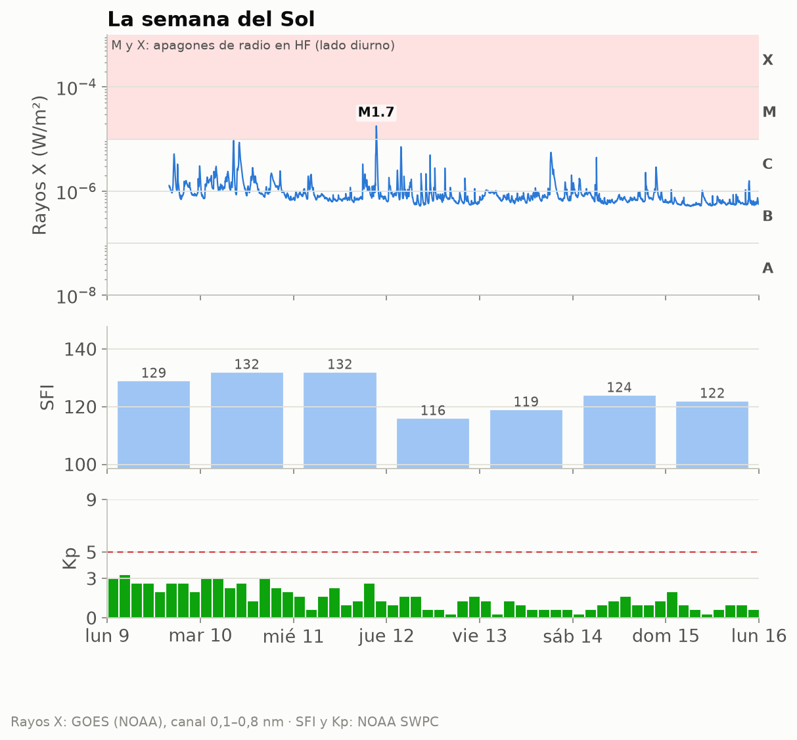
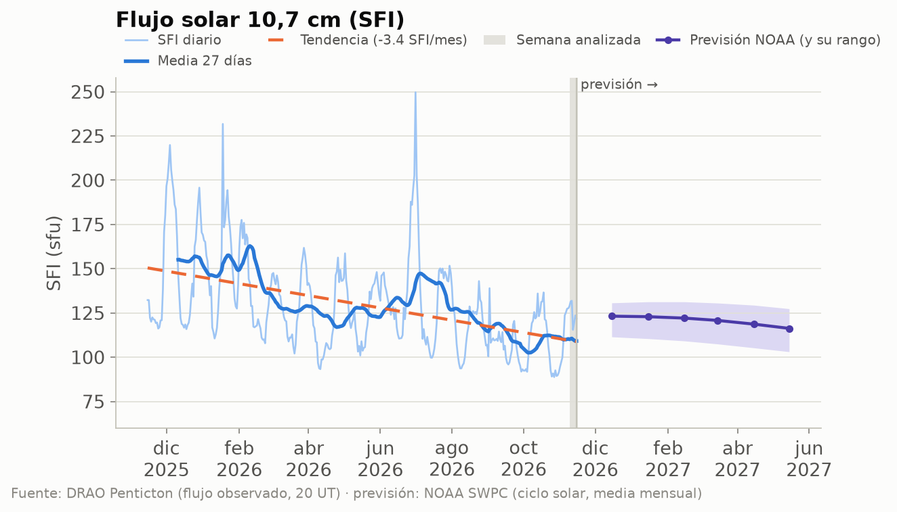
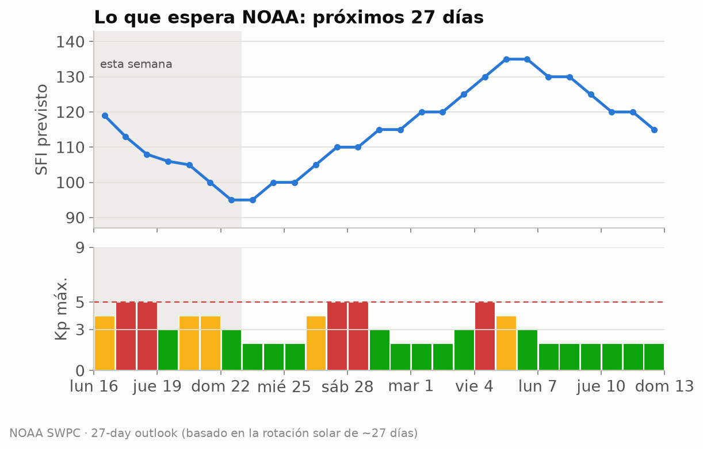
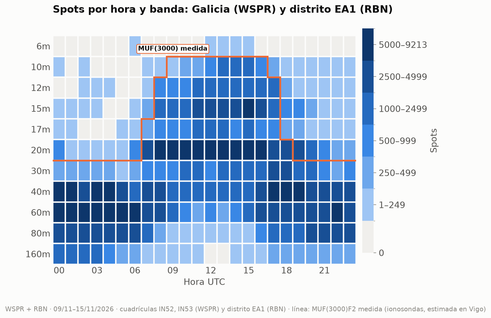
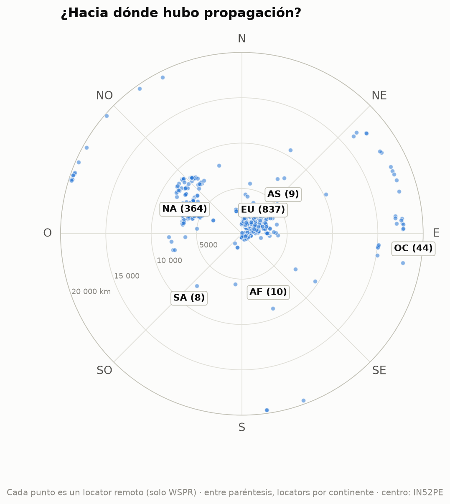
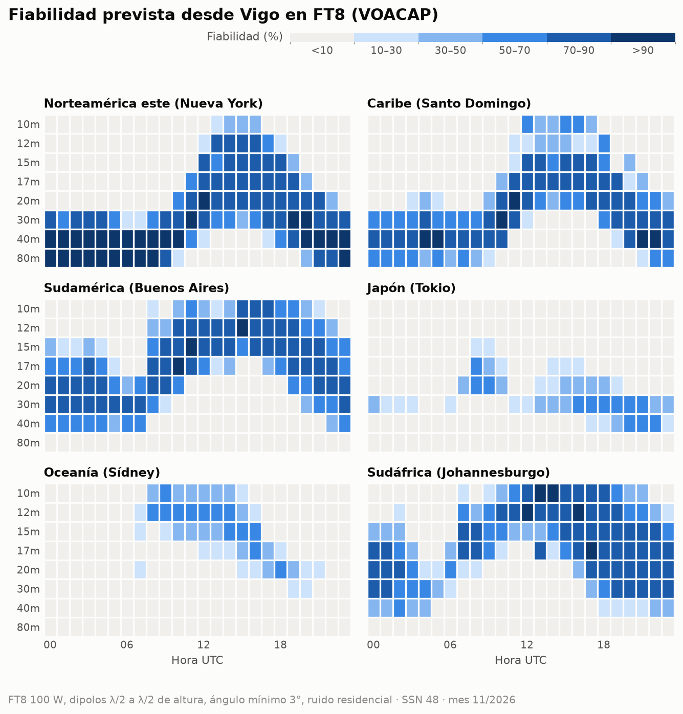
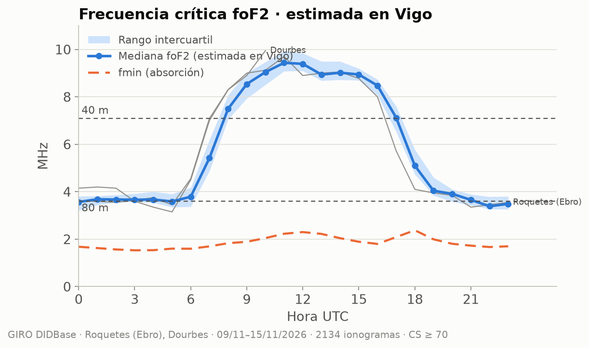

# Propagación HF/VHF desde Vigo · semana 2026-W47

**EA1RKV · Unión de Radioaficionados de Vigo-Val Miñor** · estación de referencia
Vigo (IN52PE) · semana analizada: 9 de noviembre de 2026 – 15 de noviembre de 2026 ·
previsión: lun 16/11 – dom 22/11

> Este informe combina **lo que dice la teoría** (índices solares, predicciones) con **lo que pasó
> de verdad** (spots reales desde Galicia). Todas las horas en UTC salvo que se indique lo contrario.

## 1. El Sol y el campo geomagnético

- **Flujo solar (SFI):** media **125**, máximo 132, mínimo 116 ·
  tendencia frente a la semana anterior: **al alza (+8 %)** (media previa 116).
- **SSN efectivo aproximado:** ≈ **69** (SSN ≈ 1,14·SFI − 73,2) · número de manchas observado (media): 109.
- **Campo geomagnético:** 🟢 **tranquilo** · Kp máximo **3,33** · Ap medio **6** (máx. 12).
- **Fulguraciones:** 0 de clase X y 1 de clase M — la mayor, **M1.7** (mié 11/11 21:21 UTC). Una fulguración fuerte en el lado diurno puede provocar un *apagón de radio* (absorción en la capa D) durante minutos u horas.

| Día | SFI | Manchas | Ap | Kp máx. | |
|---|---:|---:|---:|---:|:-:|
| lun 9/11 | 129 | 94 | 12 | 3,33 | 🟢 |
| mar 10/11 | 132 | 93 | 11 | 3,00 | 🟢 |
| mié 11/11 | 132 | 142 | 6 | 2,67 | 🟢 |
| jue 12/11 | 116 | 115 | 4 | 1,67 | 🟢 |
| vie 13/11 | 119 | 118 | 4 | 1,33 | 🟢 |
| sáb 14/11 | 124 | 121 | 4 | 1,67 | 🟢 |
| dom 15/11 | 122 | 83 | 4 | 2,00 | 🟢 |

_Semáforo Kp: 🟢 ≤ 3 tranquilo · 🟡 4 inquieto · 🔴 ≥ 5 tormenta._

_Cómo leerla, de arriba abajo. **Rayos X:** cada pico es una fulguración; si entra en la franja
rosa (clases M y X), en la cara iluminada de la Tierra la capa D absorbe la HF durante minutos u
horas (el famoso «apagón de radio»). Los huecos de la línea son cortes de datos: cerca de los
equinoccios el satélite pasa cada día un rato por la sombra de la Tierra. **SFI:** cuanto más alto, más arriba llega la MUF.
**Kp:** agitación del campo magnético cada 3 horas; las barras rojas son tormenta._

_Estamos en la fase descendente del ciclo 25: el SFI baja poco a poco, con altibajos de ~27 días
(la rotación del Sol). La línea discontinua naranja marca la tendencia del último año; a la
derecha, en violeta, la previsión mensual de NOAA con su rango de incertidumbre (zona sombreada)._

### ¿Qué viene? Previsión de la actividad solar

**Próximos 3 días** (NOAA, la previsión más fiable; emitida el lun 16/11 12:30 UTC):

| Día | Kp máx. previsto | | Prob. apagón de radio R1–R2 | Prob. apagón fuerte (R3+) |
|---|---:|:-:|---:|---:|
| lun 16/11 | 3,67 | 🟢 | 25 % | 5 % |
| mar 17/11 | 4,67 | 🟡 | 25 % | 5 % |
| mié 18/11 | 4,67 | 🟡 | 25 % | 5 % |

_R1–R2 = fulguración M (apagón menor o moderado en la cara diurna); R3+ = fulguración X._

**Esta semana:** SFI entre 95 y 119, Ap máximo 20 y
Kp máximo 5 (🔴 tormenta geomagnética (G1)); días con Kp ≥ 4 previstos:
lun 16/11, mar 17/11, mié 18/11, vie 20/11, sáb 21/11.

**Hasta el sáb 12/12:** SFI entre 95 y 135; posible
agitación geomagnética (Kp ≥ 4) el lun 16/11, mar 17/11, mié 18/11, vie 20/11, sáb 21/11, jue 26/11, vie 27/11, sáb 28/11, vie 4/12, sáb 5/12.
_Esta previsión se basa en que el Sol gira sobre sí mismo cada ~27 días: las regiones activas y
los agujeros coronales que vimos hace una rotación suelen «volver a asomarse». Por eso acierta
bastante con las tendencias, pero no puede anticipar una fulguración concreta._

**A largo plazo:** NOAA prevé para mayo de 2027 un SFI medio mensual de
**116** (entre 103 y 127). Es decir, el ciclo 25 sigue
bajando: poco a poco, 10 m y 12 m abrirán menos días. **Ojo:** la media de los últimos
27 días (109) va **por debajo** del rango que NOAA preveía para este mes
(unos 123): el Sol se está apagando más
deprisa de lo esperado, y las bandas altas lo notarán.

## 2. Lo que pasó de verdad desde Galicia

Esta semana se registraron **402 640 spots**: 298 915 de WSPR con una
estación gallega en un extremo (6 estaciones en las cuadrículas IN52/IN53) y
103 725 de la Reverse Beacon Network en CW/RTTY con una estación del **distrito EA1** (el RBN
no da locator, así que no podemos separar Galicia de Asturias, Cantabria y Castilla y León).
Las bandas con más actividad fueron **40m** (86 902), **60m** (84 877), **20m** (84 725), **80m** (47 312), y la hora más movida, las **16 UTC**.

_Cómo leerlo: cada casilla es una hora UTC en una banda; cuanto más oscura, más spots. Fíjate en
cómo las bandas altas (10–15 m) se «encienden» con el Sol y las bajas (40–80 m) de noche._

_La línea naranja es la **MUF(3000)F2 medida** por las ionosondas: por debajo de ella, la teoría dice
que la banda abre para un salto de 3 000 km. Si los spots siguen la línea, teoría y realidad coinciden._

### DX de la semana por banda

| Banda | Distancia | Estación gallega (WSPR) | Corresponsal | Locator | Continente | Cuándo | SNR |
|---|---:|---|---|---|---|---|---:|
| 160m | 5 782 km | EB1A | W4KEL (oyó a Galicia) | FM08rd | Norteamérica | lun 9/11 03:12 UTC | -24 dB |
| 80m | 19 569 km | EB1A | ZL4SY (oyó a Galicia) | RE44pb | Oceanía | mié 11/11 07:42 UTC | -24 dB |
| 60m | 17 045 km | EB1A | VK5ARG (oyó a Galicia) | PF95ht | Oceanía | lun 9/11 20:18 UTC | -24 dB |
| 40m | 19 820 km | EB1A | ZL2005SWL (oyó a Galicia) | RE68mx | Oceanía | vie 13/11 08:12 UTC | -25 dB |
| 30m | 19 820 km | EB1A | ZL2005SWL (oyó a Galicia) | RE68mx | Oceanía | vie 13/11 07:52 UTC | -26 dB |
| 20m | 19 820 km | EB1A | ZL2005SWL (oyó a Galicia) | RE68mx | Oceanía | jue 12/11 07:28 UTC | -19 dB |
| 17m | 17 045 km | EB1A | VK5ARG (oyó a Galicia) | PF95ht | Oceanía | dom 15/11 05:50 UTC | -20 dB |
| 15m | 19 820 km | EB1A | ZL2005SWL (oyó a Galicia) | RE68mx | Oceanía | dom 15/11 14:26 UTC | -26 dB |
| 12m | 19 820 km | EB1A | ZL2005SWL (oyó a Galicia) | RE68mx | Oceanía | mié 11/11 09:00 UTC | -26 dB |

_Distancias de círculo máximo medidas desde IN52PE (WSPR)._

### Rutas por continente

Spots de WSPR (Galicia) y RBN (distrito EA1) juntos, por continente del corresponsal:

| Continente | Spots | 160m | 80m | 60m | 40m | 30m | 20m | 17m | 15m | 12m | 10m | 6m | 
|---|---:|---:|---:|---:|---:|---:|---:|---:|---:|---:|---:|---:|
| Europa | **318 295** | 8480 | 42820 | 66152 | 71101 | 22287 | 63892 | 8268 | 23945 | 8628 | 2700 | 22 | 
| Norteamérica | **72 560** | 121 | 3899 | 17162 | 14051 | 1015 | 17566 | 1440 | 9685 | 4012 | 3609 | · | 
| África | **7 329** | 195 | 545 | 1551 | 1214 | 653 | 1345 | 274 | 734 | 401 | 409 | 8 | 
| Oceanía | **2 071** | · | 3 | 12 | 260 | 236 | 1371 | 37 | 116 | 34 | 2 | · | 
| Asia | **1 306** | 2 | 45 | · | 226 | 14 | 375 | 67 | 436 | 74 | 67 | · | 
| Sudamérica | **1 079** | · | · | · | 50 | 1 | 176 | 35 | 493 | 81 | 243 | · | 

_Mapa centrado en Vigo: el ángulo es el rumbo al que apuntaría tu antena y la distancia al centro,
los kilómetros. Solo WSPR, porque el RBN no da locator: cada punto es un locator distinto
(1 272 en total) y la cifra entre paréntesis es cuántos hay de cada continente. Por eso no
coincide con los spots de la tabla, que suman todos los spots de WSPR y RBN._

### La ionosfera medida

Datos de las digisondas de **Roquetes (Ebro)** (40,8° N), **Dourbes** (50,1° N).
Solo usamos ionogramas con confianza de autoescalado ≥ 70 % y descartamos los valores
que se salen de lo que marcan sus vecinos (los errores típicos del escalado automático).

#### ¿Hubo esporádica E esta semana?

**Algo:** la foEs pasó de 5,6 MHz, lo bastante para aperturas cortas en 10 m, pero no llegó a 6 m.

| Ionosonda | Día | Desde | Hasta (UTC) | foEs máx. | MUF Es (~1 800 km) | Banda | Spots WSPR |
|---|---|---|---|---:|---:|---|---:|
| Roquetes (Ebro) | mar 10/11 | 14:00 | 14:20 | 7,0 MHz | 35 MHz | 10m | 0 |
| Roquetes (Ebro) | mar 10/11 | 15:00 | 15:00 | 8,7 MHz | 43 MHz | 10m | 0 |
| Roquetes (Ebro) | mar 10/11 | 16:35 | 17:30 | 8,0 MHz | 40 MHz | 10m | 0 |
| Roquetes (Ebro) | mié 11/11 | 11:40 | 12:30 | 7,0 MHz | 35 MHz | 10m | 0 |
| Roquetes (Ebro) | mié 11/11 | 13:10 | 13:15 | 8,1 MHz | 40 MHz | 10m | 0 |
| Roquetes (Ebro) | sáb 14/11 | 10:45 | 12:15 | 7,2 MHz | 36 MHz | 10m | 0 |
| Roquetes (Ebro) | vie 13/11 | 10:40 | 11:25 | 7,5 MHz | 38 MHz | 10m | 0 |
| Roquetes (Ebro) | vie 13/11 | 12:30 | 14:55 | 8,3 MHz | 42 MHz | 10m | 0 |

_La MUF de la Es para un salto de 1 500–2 000 km es unas 5 veces la foEs. «Spots WSPR»: spots de esa
banda a 800–2 500 km desde Galicia durante el episodio._

#### Teoría frente a realidad

Comparamos, hora a hora, lo que dice la MUF(3000) medida con lo que se oyó de verdad a 2 000–4 000 km
(un salto de F2) en 20m, 17m, 15m, 12m. **Coinciden en el 81 %** de las
96 casillas hora × banda. En 18
hubo spots aunque la MUF típica no llegaba, sobre todo en 20m y 12m: días mejores
que la mediana o esporádica E. La línea naranja del mapa de calor muestra lo mismo de un vistazo.

#### Notas curiosas (Roquetes (Ebro))

- La capa F2 tuvo su pico a **244 km** de altura a mediodía y a 317 km de noche.
- La capa F1 apareció de día, con foF1 de hasta 4,9 MHz (13:15 UTC).
- **Spread-F:** se vio en 7 noche(s) (10 h en total). Son irregularidades de la capa F que en la radio se notan como *flutter* y ecos, sobre todo en 40–80 m de madrugada.

## 3. Previsión para la semana (lun 16/11 – dom 22/11)

### DX: fiabilidad prevista (VOACAP)

**En FT8** (el modo más usado, y el más parecido a los spots WSPR/RBN de la sección 2): bandas con
fiabilidad media ≥ 50 % por franja horaria (UTC), la mejor primero. En cursiva, la mejor banda
cuando ninguna llega al 50 % (apertura posible pero poco fiable):

| Destino | km | Rumbo | 00–04 | 04–08 | 08–12 | 12–16 | 16–20 | 20–24 | 
|---|---:|---:|---|---|---|---|---|---|
| Norteamérica este (Nueva York) | 5 307 | 291° | 80m, 40m, 30m | 80m, 40m, 30m | 40m, 30m | 20m, 17m, 15m | 20m, 30m, 17m | 40m, 30m, 80m | 
| Caribe (Santo Domingo) | 6 288 | 265° | 40m, 80m, 30m | 40m, 30m, 80m | 30m, 40m, 20m | 17m, 15m, 20m | 17m, 20m, 15m | 40m, 30m, 20m | 
| Sudamérica (Buenos Aires) | 9 922 | 219° | 20m, 30m, 17m | 30m, 20m, 40m | 17m, 15m, 20m | 12m, 15m | 12m, 15m, 10m | 17m, 20m, 15m | 
| Japón (Tokio) | 10 780 | 25° | _30m (24 %)_ | — | _20m (37 %)_ | _30m (34 %)_ | 30m | 30m | 
| Oceanía (Sídney) | 18 035 | 69° | — | — | 12m | 12m | _20m (37 %)_ | — | 
| Sudáfrica (Johannesburgo) | 8 489 | 146° | 20m, 30m, 17m | _20m (35 %)_ | 12m, 15m | 10m, 12m, 15m | 12m, 15m, 17m | 20m, 17m, 30m | 

**En CW** (a oído hace falta unos 14 dB más de señal que en FT8, así que se abren menos bandas):

| Destino | 00–04 | 04–08 | 08–12 | 12–16 | 16–20 | 20–24 | 
|---|---|---|---|---|---|---|
| Norteamérica este (Nueva York) | 40m, 80m | 40m, 80m | 40m, 30m | 20m, 17m | 20m, 17m | 40m, 30m | 
| Caribe (Santo Domingo) | 40m | 40m | _30m (40 %)_ | _17m (44 %)_ | 17m | 30m, 40m | 
| Sudamérica (Buenos Aires) | 20m | _30m (48 %)_ | 15m, 17m | 12m | 12m | 17m | 
| Japón (Tokio) | — | — | — | — | _30m (25 %)_ | _30m (22 %)_ | 
| Oceanía (Sídney) | — | — | _12m (25 %)_ | _12m (26 %)_ | — | — | 
| Sudáfrica (Johannesburgo) | _20m (49 %)_ | — | _12m (42 %)_ | 10m, 12m | 12m, 10m, 15m | 17m | 

_Supuestos: 100 W, dipolos de media onda a media longitud de onda de altura en los dos extremos,
ángulo de salida mínimo de 3° y ruido residencial. SSN usado: **48** (SSN efectivo del SFI previsto (107)).
En SSB hacen falta ~30 dB más que en FT8. VOACAP describe el promedio mensual: un día concreto puede
ir mucho mejor o peor._

### NVIS y contactos regionales (80 y 40 m)

Combinando Roquetes (Ebro), Dourbes y llevándolas a la latitud y la hora local de Vigo
(El Arenosillo sola, 5° más al sur, resulta algo optimista), la **foF2 mediana estimada en Vigo fue de
4,6 MHz** la
semana pasada: de 3,4 MHz de madrugada a 9,4 MHz hacia las
11 UTC. El pico de la
capa F2 estuvo de mediana a 262 km.

| Trayecto | sec φ | 80 m abierta | 40 m abierta | MUF (mín.–máx.) |
|---|---:|---|---|---|
| NVIS (Galicia, < 200 km) | 1,00 | 07–20 UTC | 09–17 UTC | 3,4–9,4 MHz |
| Vigo – Madrid (~460 km) | 1,32 | 19–11, 14–18 UTC · _absorción: 11–14, 18–19 UTC_ | 08–18 UTC | 4,2–12,9 MHz |
| Vigo – Barcelona (~900 km) | 1,90 | 22–08 UTC · _absorción: 08–22 UTC_ | 07–19 UTC | 5,9–19,0 MHz |

**A 3 000 km** (un salto de F2, p. ej. Canarias–Escandinavia): la **MUF(3000)F2 medida** fue de
10,5 a 32,2 MHz (máxima hacia las 11 UTC).
20m: 07–19 UTC · 17m: 08–18 UTC · 15m: 08–18 UTC · 12m: 09–17 UTC · 10m: 10–13 UTC.

> **¿Por qué importa foF2?** Es la frecuencia más alta que la capa F2 devuelve a tierra cuando
> la señal sube en vertical. En NVIS (*Near Vertical Incidence Skywave*, antenas bajas que radian
> hacia arriba) solo rebotan las frecuencias **por debajo de foF2**: si foF2 cae por debajo de
> 7,1 MHz, los 40 m «saltan» Galicia y hay que bajar a 80 m. Para trayectos más largos la señal
> llega inclinada y la capa aguanta más: la MUF de un salto es aproximadamente
> **foF2 · sec(φ)**, donde φ es el ángulo de incidencia en la ionosfera, calculado con la altura
> real del pico (hmF2) que mide la ionosonda. Para 3 000 km usamos directamente la MUF(3000)F2 que
> publica la digisonda, que ya tiene en cuenta la curvatura de la Tierra.
>
> **¿Y por abajo?** La capa D absorbe las frecuencias bajas de día. La **fmin** (frecuencia más
> baja del ionograma) sube a mediodía por esa absorción: la usamos para estimar la LUF
> (≈ fmin · √sec φ en la capa D). Una banda está «abierta» si la MUF la supera con un 10 % de
> margen y la LUF queda por debajo; «absorción» son las horas en que la MUF la deja pasar pero la
> capa D la cierra.

### Línea gris

El jue 19/11, en Vigo amanece a las **07:29 UTC** y anochece a las **17:10 UTC**.
Durante el crepúsculo la absorción de la capa D desaparece antes de que se deshaga la capa F: es
el momento de buscar DX en 160, 80 y 40 m a lo largo del terminador.

| Destino | Orto DX | Ocaso DX | Terminador común (±45 min) | Noche en los dos extremos |
|---|---|---|---|---|
| Norteamérica este (Nueva York) | 11:47 | 21:34 | — | 21:35–07:29 |
| Caribe (Santo Domingo) | 10:48 | 22:01 | — | 22:01–07:29 |
| Sudamérica (Buenos Aires) | 08:37 | 22:40 | 07:52–08:14 UTC (orto Vigo / orto DX) | 22:39–07:29 |
| Japón (Tokio) | 21:20 | 07:32 | 06:47–08:14 UTC (orto Vigo / ocaso DX) | 17:10–21:21 |
| Oceanía (Sídney) | 18:41 | 08:39 | 07:54–08:14 UTC (orto Vigo / ocaso DX) | 17:10–18:40 |
| Sudáfrica (Johannesburgo) | 03:09 | 16:37 | 16:25–17:22 UTC (ocaso Vigo / ocaso DX) | 17:10–03:09 |

_El «terminador común» es la línea gris propiamente dicha (amanecer o anochecer a la vez en los dos
extremos). La «noche en los dos extremos» es la ventana para 160 y 80 m, y a menudo para 40 m._

## 4. Agenda y efemérides

### Concursos del fin de semana

| Concurso | Empieza (UTC) | Termina (UTC) | Horas |
|---|---|---|---:|
| [AWA Bruce Kelley 1929 QSO Party](https://www.contestcalendar.com/weeklycontdetails.php?ref=0039xrm7) | sáb 14/11 23:00 | lun 23/11 03:00 | 196 |
| [K1USN Slow Speed Test](https://www.contestcalendar.com/weeklycontdetails.php?ref=003gkyux) | vie 20/11 20:00 | vie 20/11 21:00 | 1 |
| [LZ DX Contest](https://www.contestcalendar.com/weeklycontdetails.php?ref=003ge3kb) | sáb 21/11 12:00 | dom 22/11 12:00 | 24 |
| [All Austrian 160-Meter Contest](https://www.contestcalendar.com/weeklycontdetails.php?ref=003gbiz0) | sáb 21/11 16:00 | sáb 21/11 23:59 | 8 |
| [REF 160-Meter Contest](https://www.contestcalendar.com/weeklycontdetails.php?ref=003gf6gu) | sáb 21/11 17:00 | dom 22/11 00:00 | 7 |
| [South American Integration Contest CW](https://www.contestcalendar.com/weeklycontdetails.php?ref=003gflzs) | sáb 21/11 18:00 | dom 22/11 21:00 | 27 |
| [Feld Hell Sprint](https://www.contestcalendar.com/weeklycontdetails.php?ref=003g6dz8) | sáb 21/11 19:00 | sáb 21/11 20:59 | 2 |
| [RSGB 1.8 MHz Contest](https://www.contestcalendar.com/weeklycontdetails.php?ref=003gfdws) | sáb 21/11 20:00 | sáb 21/11 23:00 | 3 |
| [ARRL Sweepstakes Contest, SSB](https://www.contestcalendar.com/weeklycontdetails.php?ref=003gbyea) | sáb 21/11 21:00 | lun 23/11 03:00 | 30 |

### Lluvias de meteoros (meteor scatter en 6 m y 2 m)

- **Leónidas** — máximo mar 17/11 (dentro de 1 días), THZ ≈ 15 · _activa esta semana_.
- **Gemínidas** — máximo lun 14/12 (dentro de 28 días), THZ ≈ 150 · la más intensa del año.

_Consejo: el meteor scatter funciona mejor al amanecer local, cuando la Tierra «barre» los
meteoros de frente. Modos: MSK144 (6 m/2 m) con WSJT-X._

### Pases de satélites desde Vigo

Los mejores pases (elevación máxima ≥ 30°) de cada satélite:

| Satélite | Día | AOS (UTC) | LOS (UTC) | Hora local | Elev. máx. | Min |
|---|---|---|---|---|---:|---:|
| RS-44 | lun 16/11 | 00:14 | 00:33 | 01:14 | 88° | 20 |
| FO-29 | lun 16/11 | 05:57 | 06:13 | 06:57 | 75° | 15 |
| AO-7 | lun 16/11 | 07:49 | 08:11 | 08:49 | 87° | 22 |
| SO-50 | lun 16/11 | 08:32 | 08:46 | 09:32 | 64° | 14 |
| RS-44 | lun 16/11 | 12:51 | 13:13 | 13:51 | 79° | 22 |
| FO-29 | lun 16/11 | 18:49 | 19:06 | 19:49 | 65° | 17 |
| AO-27 | lun 16/11 | 22:11 | 22:26 | 23:11 | 78° | 15 |
| ISS | lun 16/11 | 23:09 | 23:20 | 00:09 | 75° | 11 |
| SO-50 | mar 17/11 | 22:59 | 23:13 | 23:59 | 67° | 14 |
| FO-29 | mié 18/11 | 05:52 | 06:07 | 06:52 | 68° | 15 |
| AO-7 | mié 18/11 | 07:42 | 08:04 | 08:42 | 86° | 22 |
| AO-123 | mié 18/11 | 08:47 | 08:58 | 09:47 | 78° | 11 |
| ISS | mié 18/11 | 16:41 | 16:52 | 17:41 | 89° | 11 |
| AO-123 | mié 18/11 | 21:41 | 21:52 | 22:41 | 81° | 11 |
| AO-27 | jue 19/11 | 11:02 | 11:17 | 12:02 | 82° | 15 |
| RS-44 | vie 20/11 | 12:33 | 12:55 | 13:33 | 87° | 22 |
| SO-50 | vie 20/11 | 22:10 | 22:24 | 23:10 | 67° | 14 |
| AO-123 | sáb 21/11 | 21:31 | 21:42 | 22:31 | 57° | 11 |
| AO-27 | dom 22/11 | 11:12 | 11:27 | 12:12 | 83° | 15 |
| ISS | dom 22/11 | 15:06 | 15:17 | 16:06 | 87° | 11 |
| AO-7 | dom 22/11 | 18:27 | 18:49 | 19:27 | 82° | 22 |

## 5. Comentario del club

<!-- COMENTARIO -->
> PENDIENTE: un socio debe escribir aquí su comentario (qué trabajó, qué oyó, qué recomienda
> para la semana). **El informe no se publica sin este párrafo.**
<!-- /COMENTARIO -->

---

### Fuentes

- NOAA SWPC — índices solares y geomagnéticos diarios, flujo de rayos X y fulguraciones de GOES, previsión a 3 y 27 días y previsión del ciclo solar (https://www.swpc.noaa.gov/)
- NRC Canada / DRAO Penticton — histórico diario del flujo F10.7 (https://www.spaceweather.gc.ca/)
- WSPRnet vía wspr.live (https://wspr.live/)
- Reverse Beacon Network (https://www.reversebeacon.net/)
- GIRO / DIDBase, Lowell GIRO Data Center (https://giro.uml.edu/), datos CC-BY-NC-SA 4.0 de las digisondas de Roquetes (Observatori de l'Ebre), Dourbes (RMI Bélgica)
- VOACAP (voacapl, port para Linux de J. Watson; https://github.com/jawatson/voacapl)
- WA7BNM Contest Calendar (https://www.contestcalendar.com/)
- International Meteor Organization — calendario de lluvias (https://www.imo.net/)
- CelesTrak — TLE de satélites de radioaficionado (https://celestrak.org/)
- Cálculos propios: SSN efectivo, distancias de círculo máximo, MUF por ley de la secante y
  orto/ocaso (algoritmo de NOAA).

Borrador generado automáticamente el 2026-11-16 15:59 UTC por el script del radioclub
EA1RKV. Las secciones sin datos indican que la fuente no respondió esta semana.
