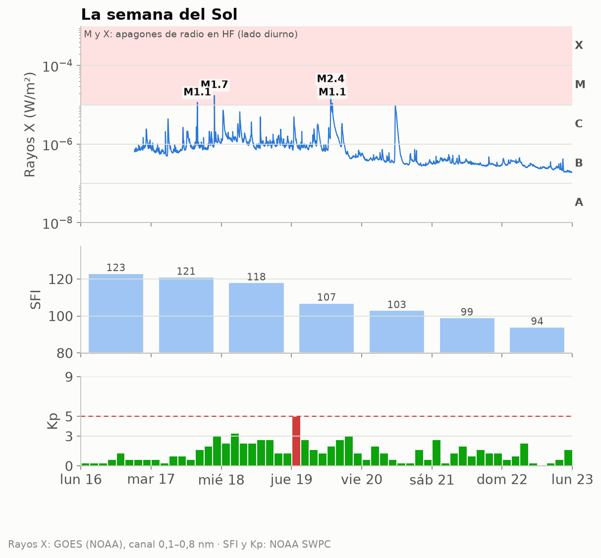
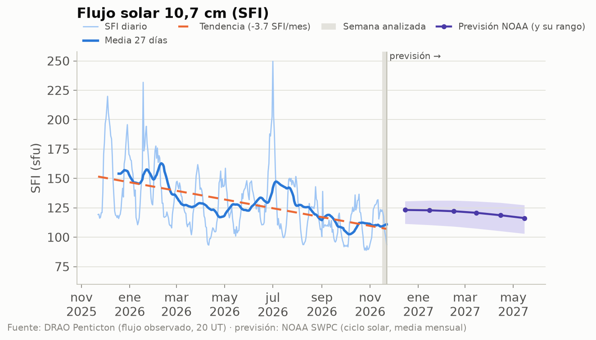
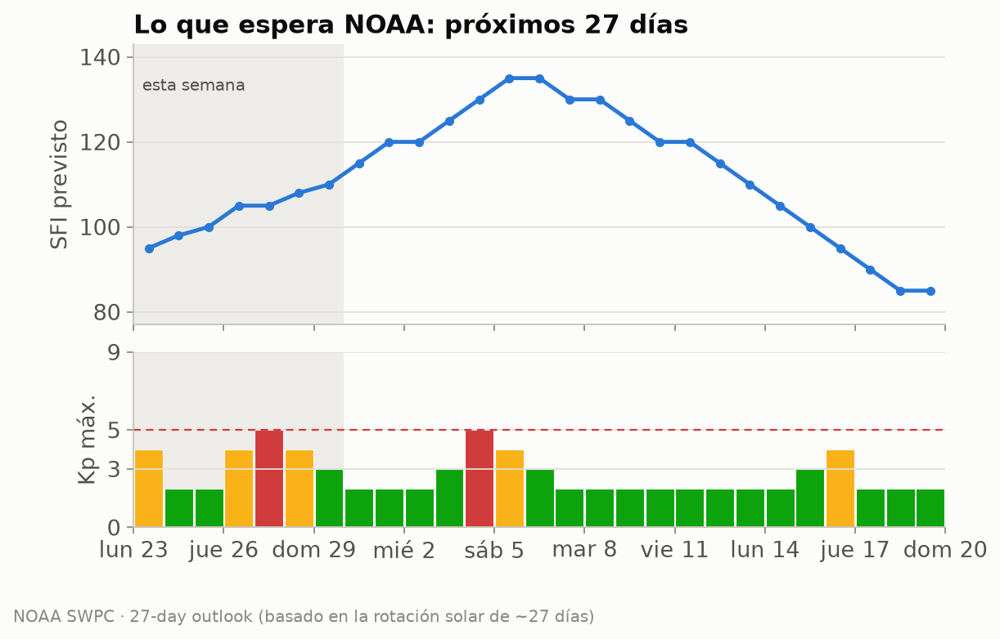
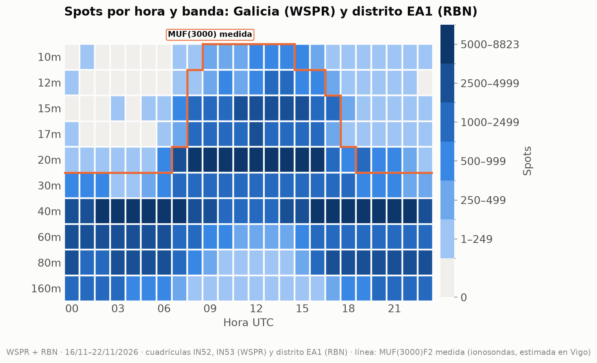
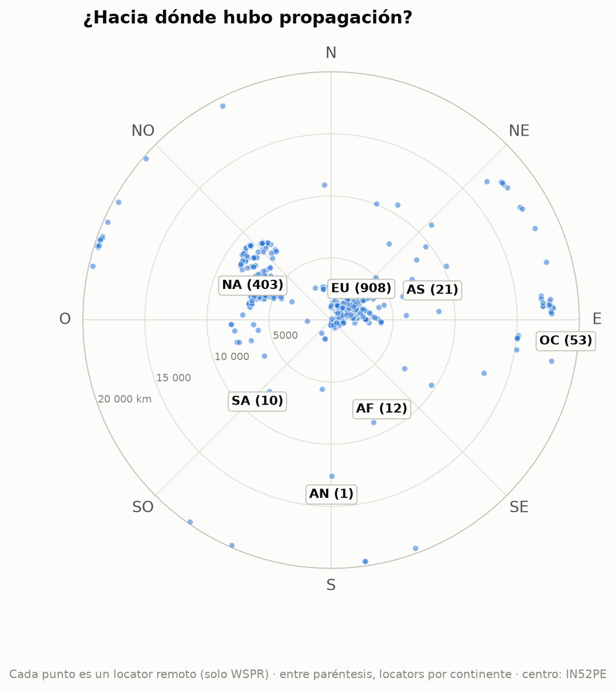
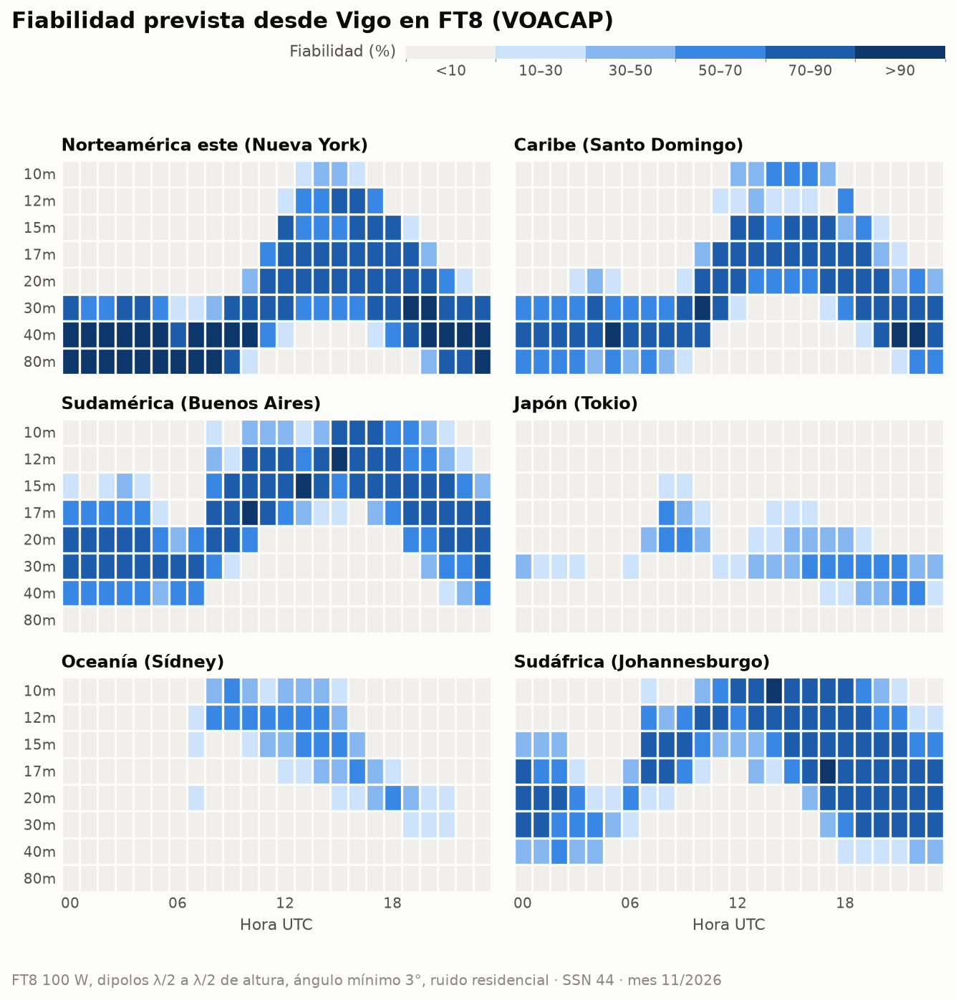
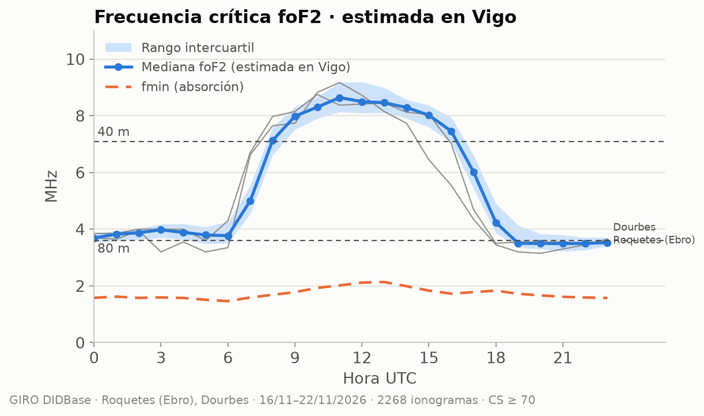

# Propagación HF/VHF desde Vigo · semana 2026-W48

**EA1RKV · Unión de Radioaficionados de Vigo-Val Miñor** · estación de referencia
Vigo (IN52PE) · semana analizada: 16 de noviembre de 2026 – 22 de noviembre de 2026 ·
previsión: lun 23/11 – dom 29/11

> Este informe combina **lo que dice la teoría** (índices solares, predicciones) con **lo que pasó
> de verdad** (spots reales desde Galicia). Todas las horas en UTC salvo que se indique lo contrario.

## 1. El Sol y el campo geomagnético

- **Flujo solar (SFI):** media **109**, máximo 123, mínimo 94 ·
  tendencia frente a la semana anterior: **a la baja (-12 %)** (media previa 125).
- **SSN efectivo aproximado:** ≈ **51** (SSN ≈ 1,14·SFI − 73,2) · número de manchas observado (media): 87.
- **Campo geomagnético:** 🔴 **tormenta geomagnética (G1)** · Kp máximo **5,00** · Ap medio **7** (máx. 14) · 1 día(s) con Kp ≥ 4.
- **Fulguraciones:** 0 de clase X y 4 de clase M — la mayor, **M2.4** (jue 19/11 13:24 UTC). Una fulguración fuerte en el lado diurno puede provocar un *apagón de radio* (absorción en la capa D) durante minutos u horas.

| Día | SFI | Manchas | Ap | Kp máx. | |
|---|---:|---:|---:|---:|:-:|
| lun 16/11 | 123 | 111 | 3 | 1,33 | 🟢 |
| mar 17/11 | 121 | 145 | 6 | 3,00 | 🟢 |
| mié 18/11 | 118 | 148 | 10 | 3,33 | 🟢 |
| jue 19/11 | 107 | 80 | 14 | 5,00 | 🔴 |
| vie 20/11 | 103 | 62 | 4 | 2,00 | 🟢 |
| sáb 21/11 | 99 | 39 | 6 | 2,67 | 🟢 |
| dom 22/11 | 94 | 23 | 4 | 2,33 | 🟢 |

_Semáforo Kp: 🟢 ≤ 3 tranquilo · 🟡 4 inquieto · 🔴 ≥ 5 tormenta._

_Cómo leerla, de arriba abajo. **Rayos X:** cada pico es una fulguración; si entra en la franja
rosa (clases M y X), en la cara iluminada de la Tierra la capa D absorbe la HF durante minutos u
horas (el famoso «apagón de radio»). Los huecos de la línea son cortes de datos: cerca de los
equinoccios el satélite pasa cada día un rato por la sombra de la Tierra. **SFI:** cuanto más alto, más arriba llega la MUF.
**Kp:** agitación del campo magnético cada 3 horas; las barras rojas son tormenta._

_Estamos en la fase descendente del ciclo 25: el SFI baja poco a poco, con altibajos de ~27 días
(la rotación del Sol). La línea discontinua naranja marca la tendencia del último año; a la
derecha, en violeta, la previsión mensual de NOAA con su rango de incertidumbre (zona sombreada)._

### ¿Qué viene? Previsión de la actividad solar

**Próximos 3 días** (NOAA, la previsión más fiable; emitida el lun 23/11 12:30 UTC):

| Día | Kp máx. previsto | | Prob. apagón de radio R1–R2 | Prob. apagón fuerte (R3+) |
|---|---:|:-:|---:|---:|
| lun 23/11 | 4,00 | 🟡 | 5 % | 1 % |
| mar 24/11 | 1,67 | 🟢 | 5 % | 1 % |
| mié 25/11 | 1,67 | 🟢 | 5 % | 1 % |

_R1–R2 = fulguración M (apagón menor o moderado en la cara diurna); R3+ = fulguración X._

**Esta semana:** SFI entre 95 y 110, Ap máximo 22 y
Kp máximo 5 (🔴 tormenta geomagnética (G1)); días con Kp ≥ 4 previstos:
lun 23/11, jue 26/11, vie 27/11, sáb 28/11.

**Hasta el sáb 19/12:** SFI entre 85 y 135; posible
agitación geomagnética (Kp ≥ 4) el lun 23/11, jue 26/11, vie 27/11, sáb 28/11, vie 4/12, sáb 5/12, mié 16/12.
_Esta previsión se basa en que el Sol gira sobre sí mismo cada ~27 días: las regiones activas y
los agujeros coronales que vimos hace una rotación suelen «volver a asomarse». Por eso acierta
bastante con las tendencias, pero no puede anticipar una fulguración concreta._

**A largo plazo:** NOAA prevé para mayo de 2027 un SFI medio mensual de
**116** (entre 103 y 127). Es decir, el ciclo 25 sigue
bajando: poco a poco, 10 m y 12 m abrirán menos días. **Ojo:** la media de los últimos
27 días (111) va **por debajo** del rango que NOAA preveía para este mes
(unos 123): el Sol se está apagando más
deprisa de lo esperado, y las bandas altas lo notarán.

## 2. Lo que pasó de verdad desde Galicia

Esta semana se registraron **388 484 spots**: 299 774 de WSPR con una
estación gallega en un extremo (8 estaciones en las cuadrículas IN52/IN53) y
88 710 de la Reverse Beacon Network en CW/RTTY con una estación del **distrito EA1** (el RBN
no da locator, así que no podemos separar Galicia de Asturias, Cantabria y Castilla y León).
Las bandas con más actividad fueron **40m** (117 026), **20m** (80 745), **80m** (51 935), **60m** (41 144), y la hora más movida, las **15 UTC**.

_Cómo leerlo: cada casilla es una hora UTC en una banda; cuanto más oscura, más spots. Fíjate en
cómo las bandas altas (10–15 m) se «encienden» con el Sol y las bajas (40–80 m) de noche._

_La línea naranja es la **MUF(3000)F2 medida** por las ionosondas: por debajo de ella, la teoría dice
que la banda abre para un salto de 3 000 km. Si los spots siguen la línea, teoría y realidad coinciden._

### DX de la semana por banda

| Banda | Distancia | Estación gallega (WSPR) | Corresponsal | Locator | Continente | Cuándo | SNR |
|---|---:|---|---|---|---|---|---:|
| 160m | 6 951 km | EB1A | KD5RXP (oyó a Galicia) | EN11 | Norteamérica | lun 16/11 07:06 UTC | -23 dB |
| 80m | 17 045 km | EB1A | VK5ARG (oyó a Galicia) | PF95ht | Oceanía | dom 22/11 19:42 UTC | -19 dB |
| 60m | 16 995 km | EB1A | VK5EI (oyó a Galicia) | PF85xr | Oceanía | mar 17/11 20:06 UTC | -26 dB |
| 40m | 19 820 km | EB1A | ZL2005SWL (oyó a Galicia) | RE68mx | Oceanía | mié 18/11 06:00 UTC | -25 dB |
| 30m | 19 820 km | EB1A | ZL2005SWL (oyó a Galicia) | RE68mx | Oceanía | mié 18/11 06:52 UTC | -24 dB |
| 20m | 19 828 km | EB1A | ZL3TKI (oyó a Galicia) | RE66hk | Oceanía | mar 17/11 07:42 UTC | -22 dB |
| 17m | 18 000 km | QA8OKW | VK7JJ (oyó a Galicia) | QE38lr | Oceanía | sáb 21/11 12:18 UTC | -18 dB |
| 15m | 19 820 km | EB1A | ZL2005SWL (oyó a Galicia) | RE68mx | Oceanía | sáb 21/11 08:14 UTC | -16 dB |
| 12m | 19 820 km | EB1A | ZL2005SWL (oyó a Galicia) | RE68mx | Oceanía | mié 18/11 09:20 UTC | -24 dB |

_Distancias de círculo máximo medidas desde IN52PE (WSPR)._

### Rutas por continente

Spots de WSPR (Galicia) y RBN (distrito EA1) juntos, por continente del corresponsal:

| Continente | Spots | 160m | 80m | 60m | 40m | 30m | 20m | 17m | 15m | 12m | 10m | 
|---|---:|---:|---:|---:|---:|---:|---:|---:|---:|---:|---:|
| Europa | **313 231** | 14122 | 47357 | 32040 | 92438 | 24548 | 67460 | 14139 | 15873 | 3531 | 1723 | 
| Norteamérica | **60 599** | 24 | 3643 | 8334 | 21397 | 2730 | 9370 | 2264 | 7885 | 2941 | 2011 | 
| África | **7 643** | 490 | 820 | 766 | 1453 | 751 | 1396 | 601 | 723 | 319 | 324 | 
| Oceanía | **2 975** | · | 5 | 4 | 854 | 404 | 1367 | 137 | 160 | 41 | 3 | 
| Asia | **2 639** | 1 | 107 | · | 849 | 10 | 837 | 49 | 615 | 15 | 156 | 
| Sudamérica | **1 396** | · | 3 | · | 35 | 22 | 315 | 81 | 596 | 96 | 248 | 
| Antártida | **1** | · | · | · | · | · | · | 1 | · | · | · | 

_Mapa centrado en Vigo: el ángulo es el rumbo al que apuntaría tu antena y la distancia al centro,
los kilómetros. Solo WSPR, porque el RBN no da locator: cada punto es un locator distinto
(1 408 en total) y la cifra entre paréntesis es cuántos hay de cada continente. Por eso no
coincide con los spots de la tabla, que suman todos los spots de WSPR y RBN._

### La ionosfera medida

Datos de las digisondas de **Roquetes (Ebro)** (40,8° N), **Dourbes** (50,1° N).
Solo usamos ionogramas con confianza de autoescalado ≥ 70 % y descartamos los valores
que se salen de lo que marcan sus vecinos (los errores típicos del escalado automático).

#### ¿Hubo esporádica E esta semana?

**Algo:** la foEs pasó de 5,6 MHz, lo bastante para aperturas cortas en 10 m, pero no llegó a 6 m.

| Ionosonda | Día | Desde | Hasta (UTC) | foEs máx. | MUF Es (~1 800 km) | Banda | Spots WSPR |
|---|---|---|---|---:|---:|---|---:|
| Roquetes (Ebro) | lun 16/11 | 11:45 | 12:10 | 6,7 MHz | 33 MHz | 10m | 0 |
| Roquetes (Ebro) | lun 16/11 | 12:55 | 13:05 | 5,8 MHz | 29 MHz | 10m | 0 |
| Roquetes (Ebro) | mar 17/11 | 12:10 | 12:10 | 6,0 MHz | 30 MHz | 10m | 0 |
| Roquetes (Ebro) | mié 18/11 | 11:00 | 12:05 | 8,3 MHz | 42 MHz | 10m | 0 |
| Roquetes (Ebro) | mié 18/11 | 23:35 | 00:25 | 6,9 MHz | 34 MHz | 10m | 0 |

_La MUF de la Es para un salto de 1 500–2 000 km es unas 5 veces la foEs. «Spots WSPR»: spots de esa
banda a 800–2 500 km desde Galicia durante el episodio._

#### Teoría frente a realidad

Comparamos, hora a hora, lo que dice la MUF(3000) medida con lo que se oyó de verdad a 2 000–4 000 km
(un salto de F2) en 20m, 17m, 15m, 12m. **Coinciden en el 86 %** de las
96 casillas hora × banda. En 13
hubo spots aunque la MUF típica no llegaba, sobre todo en 20m y 17m: días mejores
que la mediana o esporádica E. La línea naranja del mapa de calor muestra lo mismo de un vistazo.

#### Notas curiosas (Roquetes (Ebro))

- La capa F2 tuvo su pico a **235 km** de altura a mediodía y a 311 km de noche.
- La capa F1 apareció de día, con foF1 de hasta 5,0 MHz (10:55 UTC).
- **Spread-F:** se vio en 4 noche(s) (11 h en total). Son irregularidades de la capa F que en la radio se notan como *flutter* y ecos, sobre todo en 40–80 m de madrugada.

## 3. Previsión para la semana (lun 23/11 – dom 29/11)

### DX: fiabilidad prevista (VOACAP)

**En FT8** (el modo más usado, y el más parecido a los spots WSPR/RBN de la sección 2): bandas con
fiabilidad media ≥ 50 % por franja horaria (UTC), la mejor primero. En cursiva, la mejor banda
cuando ninguna llega al 50 % (apertura posible pero poco fiable):

| Destino | km | Rumbo | 00–04 | 04–08 | 08–12 | 12–16 | 16–20 | 20–24 | 
|---|---:|---:|---|---|---|---|---|---|
| Norteamérica este (Nueva York) | 5 307 | 291° | 80m, 40m, 30m | 80m, 40m | 40m, 30m | 20m, 17m, 15m | 20m, 30m, 17m | 40m, 30m, 80m | 
| Caribe (Santo Domingo) | 6 288 | 265° | 40m, 80m, 30m | 40m, 30m, 80m | 30m, 40m, 20m | 17m, 15m, 20m | 20m, 17m, 15m | 40m, 30m, 20m | 
| Sudamérica (Buenos Aires) | 9 922 | 219° | 20m, 30m, 17m | 30m, 20m, 40m | 17m, 15m, 20m | 15m, 12m | 12m, 15m, 10m | 17m, 20m, 15m | 
| Japón (Tokio) | 10 780 | 25° | _30m (25 %)_ | — | _20m (36 %)_ | _30m (34 %)_ | 30m | _30m (49 %)_ | 
| Oceanía (Sídney) | 18 035 | 69° | — | — | 12m | 12m, 15m | _20m (38 %)_ | — | 
| Sudáfrica (Johannesburgo) | 8 489 | 146° | 20m, 30m, 17m | _30m (34 %)_ | 15m, 12m | 10m, 12m, 15m | 15m, 12m, 17m | 17m, 20m, 30m | 

**En CW** (a oído hace falta unos 14 dB más de señal que en FT8, así que se abren menos bandas):

| Destino | 00–04 | 04–08 | 08–12 | 12–16 | 16–20 | 20–24 | 
|---|---|---|---|---|---|---|
| Norteamérica este (Nueva York) | 40m, 80m | 40m, 80m | 40m, 30m | 20m, 17m | 20m, 17m | 40m, 30m | 
| Caribe (Santo Domingo) | 40m | 40m | _30m (40 %)_ | _17m (45 %)_ | _17m (50 %)_ | 30m, 40m | 
| Sudamérica (Buenos Aires) | 20m | _30m (48 %)_ | 15m | 12m | 12m | 17m | 
| Japón (Tokio) | — | — | — | — | _30m (26 %)_ | _30m (20 %)_ | 
| Oceanía (Sídney) | — | — | _12m (28 %)_ | _12m (26 %)_ | — | — | 
| Sudáfrica (Johannesburgo) | 20m | — | _12m (39 %)_ | 10m | 12m, 15m, 10m | 17m | 

_Supuestos: 100 W, dipolos de media onda a media longitud de onda de altura en los dos extremos,
ángulo de salida mínimo de 3° y ruido residencial. SSN usado: **44** (SSN efectivo del SFI previsto (103)).
En SSB hacen falta ~30 dB más que en FT8. VOACAP describe el promedio mensual: un día concreto puede
ir mucho mejor o peor._

### NVIS y contactos regionales (80 y 40 m)

Combinando Roquetes (Ebro), Dourbes y llevándolas a la latitud y la hora local de Vigo
(El Arenosillo sola, 5° más al sur, resulta algo optimista), la **foF2 mediana estimada en Vigo fue de
4,1 MHz** la
semana pasada: de 3,5 MHz de madrugada a 8,6 MHz hacia las
11 UTC. El pico de la
capa F2 estuvo de mediana a 267 km.

| Trayecto | sec φ | 80 m abierta | 40 m abierta | MUF (mín.–máx.) |
|---|---:|---|---|---|
| NVIS (Galicia, < 200 km) | 1,00 | 07–19 UTC | 09–16 UTC | 3,5–8,6 MHz |
| Vigo – Madrid (~460 km) | 1,31 | todo el día | 08–18 UTC | 4,4–12,2 MHz |
| Vigo – Barcelona (~900 km) | 1,88 | 19–09 UTC · _absorción: 09–19 UTC_ | 07–19 UTC | 6,0–18,2 MHz |

**A 3 000 km** (un salto de F2, p. ej. Canarias–Escandinavia): la **MUF(3000)F2 medida** fue de
10,7 a 30,9 MHz (máxima hacia las 11 UTC).
20m: 07–18 UTC · 17m: 08–18 UTC · 15m: 08–17 UTC · 12m: 09–16 UTC · 10m: cerrada.

> **¿Por qué importa foF2?** Es la frecuencia más alta que la capa F2 devuelve a tierra cuando
> la señal sube en vertical. En NVIS (*Near Vertical Incidence Skywave*, antenas bajas que radian
> hacia arriba) solo rebotan las frecuencias **por debajo de foF2**: si foF2 cae por debajo de
> 7,1 MHz, los 40 m «saltan» Galicia y hay que bajar a 80 m. Para trayectos más largos la señal
> llega inclinada y la capa aguanta más: la MUF de un salto es aproximadamente
> **foF2 · sec(φ)**, donde φ es el ángulo de incidencia en la ionosfera, calculado con la altura
> real del pico (hmF2) que mide la ionosonda. Para 3 000 km usamos directamente la MUF(3000)F2 que
> publica la digisonda, que ya tiene en cuenta la curvatura de la Tierra.
>
> **¿Y por abajo?** La capa D absorbe las frecuencias bajas de día. La **fmin** (frecuencia más
> baja del ionograma) sube a mediodía por esa absorción: la usamos para estimar la LUF
> (≈ fmin · √sec φ en la capa D). Una banda está «abierta» si la MUF la supera con un 10 % de
> margen y la LUF queda por debajo; «absorción» son las horas en que la MUF la deja pasar pero la
> capa D la cierra.

### Línea gris

El jue 26/11, en Vigo amanece a las **07:38 UTC** y anochece a las **17:05 UTC**.
Durante el crepúsculo la absorción de la capa D desaparece antes de que se deshaga la capa F: es
el momento de buscar DX en 160, 80 y 40 m a lo largo del terminador.

| Destino | Orto DX | Ocaso DX | Terminador común (±45 min) | Noche en los dos extremos |
|---|---|---|---|---|
| Norteamérica este (Nueva York) | 11:55 | 21:31 | — | 21:31–07:38 |
| Caribe (Santo Domingo) | 10:52 | 22:01 | — | 22:01–07:38 |
| Sudamérica (Buenos Aires) | 08:34 | 22:47 | 07:49–08:23 UTC (orto Vigo / orto DX) | 22:46–07:38 |
| Japón (Tokio) | 21:27 | 07:29 | 06:53–08:14 UTC (orto Vigo / ocaso DX) | 17:05–21:28 |
| Oceanía (Sídney) | 18:38 | 08:46 | 08:01–08:23 UTC (orto Vigo / ocaso DX) | 17:05–18:38 |
| Sudáfrica (Johannesburgo) | 03:07 | 16:42 | 16:20–17:27 UTC (ocaso Vigo / ocaso DX) | 17:06–03:07 |

_El «terminador común» es la línea gris propiamente dicha (amanecer o anochecer a la vez en los dos
extremos). La «noche en los dos extremos» es la ventana para 160 y 80 m, y a menudo para 40 m._

## 4. Agenda y efemérides

### Concursos del fin de semana

| Concurso | Empieza (UTC) | Termina (UTC) | Horas |
|---|---|---|---:|
| [K1USN Slow Speed Test](https://www.contestcalendar.com/weeklycontdetails.php?ref=003gl6kp) | vie 27/11 20:00 | vie 27/11 21:00 | 1 |
| [ARRL EME Contest](https://www.contestcalendar.com/weeklycontdetails.php?ref=003drsoh) | sáb 28/11 00:00 | dom 29/11 23:59 | 48 |
| [CQ Worldwide DX Contest, CW](https://www.contestcalendar.com/weeklycontdetails.php?ref=003gc64g) | sáb 28/11 00:00 | lun 30/11 00:00 | 48 |

### Lluvias de meteoros (meteor scatter en 6 m y 2 m)

- **Leónidas** — máximo mar 17/11 (hace 6 días), THZ ≈ 15 · _activa esta semana_.
- **Gemínidas** — máximo lun 14/12 (dentro de 21 días), THZ ≈ 150 · la más intensa del año.
- **Úrsidas** — máximo mar 22/12 (dentro de 29 días), THZ ≈ 10.

_Consejo: el meteor scatter funciona mejor al amanecer local, cuando la Tierra «barre» los
meteoros de frente. Modos: MSK144 (6 m/2 m) con WSJT-X._

### Pases de satélites desde Vigo

Los mejores pases (elevación máxima ≥ 30°) de cada satélite:

| Satélite | Día | AOS (UTC) | LOS (UTC) | Hora local | Elev. máx. | Min |
|---|---|---|---|---|---:|---:|
| SO-50 | lun 23/11 | 21:22 | 21:36 | 22:22 | 67° | 14 |
| AO-27 | lun 23/11 | 22:00 | 22:15 | 23:00 | 83° | 15 |
| RS-44 | mar 24/11 | 12:14 | 12:36 | 13:14 | 84° | 22 |
| AO-7 | mar 24/11 | 18:20 | 18:42 | 19:20 | 89° | 22 |
| ISS | mar 24/11 | 20:00 | 20:10 | 21:00 | 71° | 11 |
| FO-29 | mié 25/11 | 19:17 | 19:35 | 20:17 | 74° | 18 |
| AO-123 | jue 26/11 | 08:51 | 09:02 | 09:51 | 89° | 11 |
| ISS | jue 26/11 | 13:31 | 13:42 | 14:31 | 84° | 11 |
| AO-7 | jue 26/11 | 18:12 | 18:35 | 19:12 | 84° | 22 |
| SO-50 | jue 26/11 | 20:33 | 20:47 | 21:33 | 67° | 14 |
| AO-123 | jue 26/11 | 21:45 | 21:56 | 22:45 | 87° | 11 |
| AO-27 | jue 26/11 | 22:09 | 22:24 | 23:09 | 82° | 15 |
| RS-44 | jue 26/11 | 22:54 | 23:14 | 23:54 | 84° | 20 |
| FO-29 | vie 27/11 | 19:11 | 19:30 | 20:11 | 80° | 19 |
| ISS | vie 27/11 | 19:12 | 19:23 | 20:12 | 72° | 11 |
| RS-44 | sáb 28/11 | 11:56 | 12:17 | 12:56 | 76° | 21 |
| AO-7 | dom 29/11 | 07:59 | 08:21 | 08:59 | 79° | 22 |
| AO-27 | dom 29/11 | 11:01 | 11:16 | 12:01 | 79° | 15 |
| FO-29 | dom 29/11 | 19:06 | 19:25 | 20:06 | 85° | 19 |
| SO-50 | dom 29/11 | 19:45 | 19:59 | 20:45 | 67° | 14 |
| AO-123 | dom 29/11 | 21:35 | 21:46 | 22:35 | 66° | 11 |

## 5. Comentario del club

<!-- COMENTARIO -->
> PENDIENTE: un socio debe escribir aquí su comentario (qué trabajó, qué oyó, qué recomienda
> para la semana). **El informe no se publica sin este párrafo.**
<!-- /COMENTARIO -->

---

### Fuentes

- NOAA SWPC — índices solares y geomagnéticos diarios, flujo de rayos X y fulguraciones de GOES, previsión a 3 y 27 días y previsión del ciclo solar (https://www.swpc.noaa.gov/)
- NRC Canada / DRAO Penticton — histórico diario del flujo F10.7 (https://www.spaceweather.gc.ca/)
- WSPRnet vía wspr.live (https://wspr.live/)
- Reverse Beacon Network (https://www.reversebeacon.net/)
- GIRO / DIDBase, Lowell GIRO Data Center (https://giro.uml.edu/), datos CC-BY-NC-SA 4.0 de las digisondas de Roquetes (Observatori de l'Ebre), Dourbes (RMI Bélgica)
- VOACAP (voacapl, port para Linux de J. Watson; https://github.com/jawatson/voacapl)
- WA7BNM Contest Calendar (https://www.contestcalendar.com/)
- International Meteor Organization — calendario de lluvias (https://www.imo.net/)
- CelesTrak — TLE de satélites de radioaficionado (https://celestrak.org/)
- Cálculos propios: SSN efectivo, distancias de círculo máximo, MUF por ley de la secante y
  orto/ocaso (algoritmo de NOAA).

Borrador generado automáticamente el 2026-11-23 18:22 UTC por el script del radioclub
EA1RKV. Las secciones sin datos indican que la fuente no respondió esta semana.
